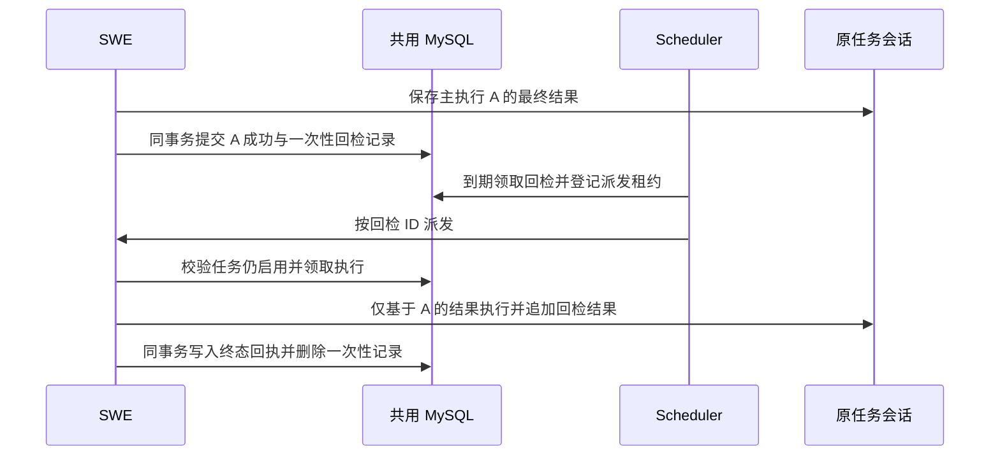

# 定时任务回检详细设计

## 设计结论

在 Scheduler 托管的 Agent 定时任务上增加一组可选的回检配置。SWE 确认本轮 Agent 成功时，自动登记一条独立的一次性任务。Scheduler 到期派发，SWE 在原任务会话里执行并追加结果。回检进入终态后，系统删除待执行记录并保存最小回执。

一期覆盖普通和批调度实际发起的新版 Agent 执行，以每次成功的 `execution_id` 为单位。回检始终由 Scheduler 按到期时间逐条派发。一次性任务由系统内部管理，配置入口沿用原定时任务编辑页和管理接口。本文以 `codex/cron-task-tracking` 工作树核对接口、执行及会话链路。

## 用户规则

| 规则 | 行为 |
| --- | --- |
| R1 配置 | 原定时任务编辑页提供「回检延迟」和「回检指令」两个字段。用户可单独填写和修改回检指令，主任务指令和回检指令分别保存。每次符合条件的主执行最多生成一条回检。 |
| R2 起算 | `run_at = 主执行 finished_at + delay_seconds`。Agent 执行成功即起算，异步结果可以仍在处理中。 |
| R3 会话 | 使用本轮任务已绑定的 `task_chat_id` 和 `task_session_id`。回检作为独立一轮追加到同一会话。 |
| R4 输入 | 回检只接收配置指令与对应主执行的最终结果。同会话之后出现的消息和其他轮次结果与本次输入无关。 |
| R5 停用与删除 | 原任务停用或删除时取消尚未开始的回检。已开始的回检允许收尾。 |
| R6 清理 | 回检成功、最终失败或取消后删除一次性调度记录，并保存去重及排查所需的最小回执。回检结果随原会话保存，原任务删除后沿用其会话清理策略。 |
| R7 查看 | 在「定时任务（新）」页的「回检任务」标签中切换「当前任务」和「历史记录」，分别查看尚未结束和已结束的回检。 |

设计默认采用执行快照。主任务受理时冻结回检配置，之后编辑指令或延迟影响后续受理的执行。停用和删除优先于快照，重新启用后，失效水位之前的主执行和回检都不会恢复回检资格。一次性回检自身的成功也不会生成下一条回检。

## 正常流程

例如 Agent 于 10:00 成功提交报表 A，回检延迟为 120 分钟。Scheduler 最早在 12:00 派发，即使此时 A 的异步状态仍未结束。11:00 成功提交的报表 B 会产生自己的回检，A 和 B 的回检各自使用对应的结果。

## 配置与存储

沿用托管任务创建、更新与查询的定义契约，在 `spec` 增加可选对象 `recheck`。建议一期将 `delay_seconds` 限定为 60–604800 的整数，对应 1 分钟至 7 天，控制台支持分钟和小时输入并统一换算。`instruction` 去掉首尾空白后须为 1–4000 字符，执行时与父结果共同受模型上下文预算约束。旧定义缺字段时视为未配置。更新接口沿用现有版本校验，显式 `null` 清除配置，旧客户端省略字段时保留原配置。授权与可见范围沿用原任务编辑权限。[任务定义校验](../../scheduler/src/scheduler/app/services/cron/managed/definition.py) · [任务编辑页](../../console/src/pages/Control/SchedulerCronJobs/ManagedJobEditor.tsx)

配置形状为 `recheck: { delay_seconds: 7200, instruction: "核对本轮提交的报表是否已入库" }`。Scheduler 定义白名单、SWE `CronJobSpec` 和 Console `ManagedCronSpec` 及请求白名单都需要识别该字段。Agent 类型切换成其他类型时要求同时清除回检配置。回检字段变更走现有定义版本机制，回检设置和原周期表达式分别持久化，回检字段仅用于执行快照。[SWE 定义模型](../../src/swe/app/crons/models.py#L182) · [Console 请求白名单](../../console/src/api/modules/schedulerCron.ts)

建议新增一张内部活动表 `swe_cron_recheck_tasks`。单行承载一条待执行或执行中的回检，字段按下列用途组织。

| 字段 | 约束与用途 |
| --- | --- |
| `recheck_id`、`parent_execution_id` | `VARCHAR(64)`。回检 ID 从原执行 ID 加回检命名空间确定性生成。主键为 `recheck_id`，对 `parent_execution_id` 建唯一索引。 |
| `tenant_id`、`source_id`、`agent_id`、`job_id` | 与 `swe_cron_execution_runs` 同类型和排序规则。定位原任务时完整匹配四项。 |
| `enqueued_state_version` | `BIGINT`。继承原执行的值，启动和取消时与原任务当前失效水位比较。 |
| `payload_json` | `LONGTEXT`。保存配置指令、原任务会话绑定及归属、对应原执行最终结果的受控快照或不可变引用。快照保留到本条回检进入终态。 |
| `run_at`、`next_dispatch_at`、`created_at`、`started_at` | `DATETIME(6)` UTC。`run_at` 保持原定执行时间，`next_dispatch_at` 初始等于 `run_at`，重投和会话忙退避只更新后者。`started_at` 可空。 |
| `status`、`version`、`dispatch_attempt` | 活动状态为 `queued`、`dispatching`、`accepted`、`running`。每次状态写入推进版本。传输重投次数按现有派发上限处理，会话忙的退避单独处理。 |
| `dispatch_owner`、`dispatch_lease_until`、`run_owner`、`run_lease_until` | 区分 Scheduler 派发租约与 SWE 运行租约。租约和状态转换同时写入，过期持有者按版本和持有者核对拦截。 |

活动表至少建立 `(status, next_dispatch_at, recheck_id)` 到期索引、`(status, run_lease_until, recheck_id)` 恢复索引及 `(tenant_id, source_id, agent_id, job_id, status)` 任务索引。派发租约恢复按状态及到期时间限量扫描，建表阶段用实际扫描 SQL 核对索引命中。终态回执沿用事件表的 `occurred_at` 和 `event_order` 作为历史排序键，拟按 `(tenant_id, source_id, agent_id, event_type, occurred_at, event_order)` 增加索引，实施时用历史查询 `EXPLAIN` 核对。

按状态和到期时间建立领取索引，按完整原任务身份和状态建立取消索引。终态回执写入现有 managed dispatch event 表的独立 `recheck_terminal` 事件。`execution_id` 存回检 ID，`event_key` 以回检 ID 派生，受现有唯一索引保护。回执保存原执行 ID、终态、计划执行时间、实际开始时间、结束时间和安全错误码。按字段类型校验新增详情值，尚未确定的时间留空。回执和活动行删除在同一事务提交，普通任务的结算、未读、自动暂停、批次成功率及通知继续按主执行计算。回检指令和业务输出仅供授权执行路径使用，执行凭据沿用现有定时凭据存储，回执及日志只保存必要标识和状态时间。[派发事件契约](../../scheduler/src/scheduler/app/services/cron/managed/dispatch_events.py) · [事件表结构](../deployment/cron_batch_board_manual_create.sql)

## 执行与恢复

### 状态转换

| 转换 | 写入者及条件 |
| --- | --- |
| 生成 `queued` | SWE 在原执行成功事务内按父执行唯一键登记，初始可领取时间为 `run_at`。 |
| `queued` → `dispatching` | Scheduler 发现到期且有效，在短事务内锁定记录并写派发令牌。事务提交后调用 SWE。 |
| `dispatching` → `accepted` | SWE 校验可信身份及派发令牌，持久受理。相同 ID 的重复请求查询已有状态。 |
| `accepted` → `running` | SWE 已取得原会话执行锁，再在短事务里复核定义、失效水位、租约和状态，写实际开始时间和运行租约。 |
| 未开始 → `queued` | 会话忙或派发失败且共库确认尚未开始，释放当前派发占位并更新下次领取时间。 |
| 未开始 → 已取消 | Scheduler 按原任务失效水位清理。SWE 遇到已失效的启动请求时按同一条件收敛。 |
| `running` → 成功或失败 | SWE 持有效运行租约提交结果。恢复只核对与补交结果，超过运行租约且结果无法确认时按失败收敛。 |

所有终态都写回执并删除活动记录。对于配置或父结果异常导致无法入队的回检，登记事务直接写失败回执，计划和开始时间按实际已知值记录。取消与启动统一在原任务定义锁下串行，先检查定义与状态，再锁回检行。等待会话锁、调用模型和服务间 HTTP 均在数据库事务外进行。

### 1. SWE 登记

接在 `ExecutionWriter.complete` 持有原任务定义锁和主执行锁的事务内，通过 SWE 本地的记录写入逻辑登记。原执行结果投影完成后，核对 Agent 成功、存在回检配置、身份和会话绑定有效、原任务启用且未自动暂停，并验证父执行的 `enqueued_state_version` 未落后于当前任务的 `queue_invalidation_version`。`finished_at` 和 `run_at` 使用同一完成时间。以父执行 ID 唯一约束兜住并发登记，已完成的父执行重入沿用现有终态校验。配置为空或主执行失败时直接完成原流程。

父执行的精确结果取 Runner 已持久化的本轮最终助手内容。进入数据库事务前，按父执行键准备有界快照或受控产物引用，正常提交与完成回执恢复使用同一份输入。执行预览是截断字段，回检使用上述精确结果。冻结配置无效、无法计算到期时间、父结果缺失或超限且无法引用时，记录回检失败回执，主执行按真实结果完成。共库写入发生瞬时错误时沿用已有完成重试与回执恢复，恢复只提交已执行结果。[终态写入](../../src/swe/app/crons/managed_results.py#L303) · [精确结果提取](../../src/swe/app/runner/query_attempt.py#L916) · [恢复回执](../../src/swe/app/crons/managed_receipts.py)

### 2. Scheduler 派发与 SWE 开始

在现有 `ManagedRecoveryWorker` 下增加独立的回检处理循环，沿用其扫描节奏，按 `next_dispatch_at`、`recheck_id` 顺序限量领取。Scheduler 启动后继续领取数据库中已经到期的记录。派发依据是该条回检的时间、有效状态和租约，主任务异步结果仍在处理时也可派发。派发结果不确定时读共库核对，模型调用沿用 SWE 的现有超时和限流处理。[恢复循环](../../scheduler/src/scheduler/app/services/cron/managed/recovery.py)

建议在 SWE 现有 `/api/internal/cron/managed` 路由组内增加 `POST /rechecks/execute` 和 `POST /rechecks/recover`。请求使用现有可信内部身份头，执行请求 Body 含 `recheck_id`、`job_id` 和 `dispatch_token`。恢复请求按回检 ID 与原任务身份定位既有运行，依据租约与结果回执恢复。`202` 表示持久受理，身份不匹配按现有查无记录语义处理，旧令牌返回冲突。终态请求按稳定回执返回已有结果状态。

Scheduler 调用受保护的 SWE 内部执行入口，请求只携带回检 ID、原任务身份及派发令牌。SWE 从共库读取快照，校验租户、来源、Agent、会话归属和执行权限，按原任务身份解析当前可用的定时执行凭据。同一回检重复派发沿用同一个 ID。Runner 先取得原会话的执行锁，再在原任务定义锁内复核到期时间、启用状态、失效水位及回检租约，并原子转换到 `running`，之后沿用同一会话执行句柄完成本轮。会话锁等待超时仍属未开始，释放派发占位后退避。数据库事务只覆盖状态校验与转换。[内部执行契约](../../src/swe/app/crons/managed_execution_api.py#L197) · [会话准入](../../src/swe/app/runner/query_execution/admission.py) · [会话追加](../../src/swe/app/runner/runner.py#L6757)

沿用 Cron 的 `skip_history=True` 和会话追加路径。用独立的回检执行键保存本轮消息，把父结果作为有明确边界的普通数据输入，仅供本轮模型使用。会话持久化记录本轮回检指令和结果。引用只允许访问该父执行产生、同归属的产物。原会话已失效或原权限已撤销时结束回检并记原因。[Agent 请求构造](../../src/swe/app/crons/executor.py#L2180)

### 3. 停用、删除与终态

停用或删除在原任务定义锁下推进失效状态。待执行、派发中、已受理但未开始的回检都纳入取消范围，取消批量清理可以异步进行，实际开始的检查同步阻止旧记录启动。开始与取消均以回检继承的 `enqueued_state_version` 对比当前 `queue_invalidation_version`，避免误清理重新启用后的新回检。回检如果先提交 `running`，允许按原会话继续收尾，原任务的会话清理也要等待这条回检结束。[停用失效水位](../../scheduler/src/scheduler/app/services/cron/managed/controls.py#L299) · [删除清理门槛](../../scheduler/src/scheduler/app/services/cron/managed/management.py#L244)

派发失败且确认尚未开始时，可以用同一个 ID 按有限次数重投。已开始后遇到实例重启或网络不确定时，按回检执行键核对已保存结果，恢复路径只补交结果。运行租约仍有效时保留在途占位。租约超过执行超时与恢复宽限期，查无结果且持有者和版本核对通过时，才提交带 `outcome_unknown` 的失败回执。成功、失败和取消都在终态事务删除活动行及内嵌快照。晚到的回调只会读到既有终态或发现活动记录已失效。

## 回检任务列表

「定时任务（新）」页增加「定时任务」和「回检任务」两个标签，默认展示原有的定时任务列表。「回检任务」内默认打开「当前任务」，可切换到「历史记录」。两个视图都是只读表格，支持刷新和分页，分别显示加载失败与空状态。时间使用控制台现有格式。[新版定时任务页](../../console/src/pages/Control/SchedulerCronJobs/index.tsx)

| 视图 | 展示内容 |
| --- | --- |
| 当前任务 | 原任务名称、回检 ID、计划执行时间、开始时间和状态。`queued` 显示「待执行」，`dispatching` 和 `accepted` 显示「派发中」，`running` 显示「执行中」。 |
| 历史记录 | 原任务名称、回检 ID、原执行 ID、计划执行时间、开始时间、结束时间和结果。终态显示「成功」「失败」或「已取消」，失败和取消显示安全原因。原会话可访问时提供查看入口。 |

### 查询接口

`GET /api/scheduler/cron/rechecks` 接受 `view=active|history`、`limit` 和 `cursor`。默认 `view=active`，`limit` 与新版任务分页一致，默认 50、最大 200。响应为 `items` 和 `next_cursor`。两种视图均返回 `recheck_id`、`parent_execution_id`、`job_id`、`job_name`、`run_at`、`started_at` 和 `status`，历史记录另含 `finished_at`、可公开的 `reason_code`，以及可访问时的 `chat_id`。所有时间以带时区的 ISO 8601 UTC 返回，未知值为 `null`。接口使用现有 Scheduler API 请求层和 Header 身份。[分页及鉴权约定](../../scheduler/src/scheduler/app/routers/managed_cron.py#L41) · [Console 请求层](../../console/src/api/modules/schedulerCron.ts)

| 视图 | 数据源和游标顺序 |
| --- | --- |
| `active` | 活动表按 `(run_at, recheck_id)` 正序。停用、删除或失效水位已取消资格的未开始记录立即排除，已经开始的回检显示到收尾。 |
| `history` | `recheck_terminal` 回执按 `(occurred_at, event_order)` 倒序。回执的 `occurred_at` 是该次终态提交时间，对外映射成 `finished_at`。 |

两种视图都将完整原任务身份作为关联条件。复用新版任务列表的作用域判断，同租户、来源和 Agent 内，普通用户看自己创建的任务，管理角色沿用现有权限。历史可以关联已软删除的定义并按当前权限判断，因此会话清理后仍能看到有权查看的回执。打开原会话走现有会话权限校验，源任务管理权限与会话访问权限分别判断。游标绑定视图、调用者及作用域，切换视图、身份或每页大小时从第一页加载。非法视图或游标返回 `400`，存储未就绪返回 `503`，空页返回 `200`。单任务追踪、批看板和普通执行统计继续使用各自的事件范围，`recheck_terminal` 由回检历史消费。[原任务列表过滤](../../scheduler/src/scheduler/app/services/cron/managed/repository.py) · [单任务追踪事件](../../scheduler/src/scheduler/app/services/cron/tracking_execution.py#L219)

### 页面交互

复用新版定时任务页的标题、表格、分页及刷新样式。「当前任务」「历史记录」独立分页，选择视图后只请求该视图的一页。切换身份或视图时取消旧请求，过期响应无法覆盖新视图。刷新从第一页重新拉取，终态回执提交后下一次刷新即可看到历史。当前任务列表移除已进入终态的记录。历史中的「查看原会话」只在接口返回已授权会话 ID 时展示。可查询字段及状态在权限过滤后返回，渲染层只做展示。

## 实施与验证

| 单元 | 主要落点 | 验证场景 |
| --- | --- | --- |
| U1 配置与存储 | `scheduler/src/scheduler/app/services/cron/managed/definition.py`、`src/swe/app/crons/models.py`、`docs/deployment/`、`console/src/pages/Control/SchedulerCronJobs/ManagedJobEditor.tsx` | 旧任务往返兼容，创建与编辑保存单位换算，清除配置和旧客户端省略字段，拒绝非法延迟、空指令及非 Agent 类型。后端测试沿用 `tests/unit/scheduler/test_managed_cron_executions.py` 附近的夹具，表单覆盖 `ManagedJobEditor.test.tsx`。 |
| U2 成功登记 | `src/swe/app/crons/managed_results.py`、`managed_execution.py`、`managed_receipts.py`、`executor.py` | `finished_at + delay` 精确起算，成功后异步仍 pending 时已入队，失败与重复完成，长于预览的结果，会话清理后仍可用的快照，重启恢复只登记一次。覆盖 `tests/unit/app/test_managed_cron_execution.py` 及新增回检用例。 |
| U3 派发、执行、取消与清理 | `scheduler/src/scheduler/app/services/cron/managed/recovery.py`、删除清理链路、SWE 内部执行入口与原会话运行路径 | 到期才领取，多实例只领一次，主任务异步结果待定时到期照常领取，A/B 同会话隔离，会话忙时延后，停用与开始并发，删除等待在途，运行租约未到期不清理，恢复和终态清理。覆盖 `tests/unit/scheduler/test_managed_cron_recovery.py`、`tests/unit/routers/test_managed_cron_execution_api.py` 附近的回检用例及 `tests/integrated/scheduler/test_managed_cron_mysql.py` 附近的真实 InnoDB 并发用例。 |
| U4 当前与历史回检列表 | Scheduler 新增只读查询，`console/src/pages/Control/SchedulerCronJobs/index.tsx` 接入回检标签 | 通过 `tests/unit/scheduler/test_managed_cron_rechecks_api.py` 覆盖分页、租户和来源隔离、待执行记录失效、终态清理后可查、原任务软删除及重复终态提交。通过 `console/src/pages/Control/SchedulerCronJobs/ManagedRechecksTable.test.tsx` 覆盖视图切换、状态、刷新、空状态和查询失败。 |

## 部署顺序与验收

1. 按 U1、U2、U3、U4 顺序接入。应用发布前人工建立 `swe_cron_recheck_tasks` 和必要索引，提供独立的 `docs/deployment/cron_recheck_manual_create.sql`。测试库验证建表、读写权限、索引和真实 InnoDB 并发。
2. 先发布兼容回检配置与内部派发的 SWE、Scheduler 和 Console。回检开通校验单独检查活动表、回执写入和内部接口可达，未就绪时原 Cron 照常工作。所有实例具备登记和派发能力后，再对试点任务开放配置。启用前的历史执行保持原记录。
3. 端到端验收用同一任务产生 A、B 两轮，A 的异步结果仍待定时验证 A 的回检按时领取、仅携带 A 的结果、回写原会话，并从「当前任务」转入「历史记录」。另用停用、恢复与迟到回调交错场景验证取消与去重。
4. 回退时先停止新的回检登记，保留已登记回检的派发、取消和恢复能力，清理待执行记录并等在途回检收尾后撤回支持代码。回执保留供查询与排查。控制台验收覆盖 Chromium 108、当前浏览器及适用的 `hideMenu=true` 场景。[浏览器兼容规范](../../console/DESIGN.md#browser-compatibility)
