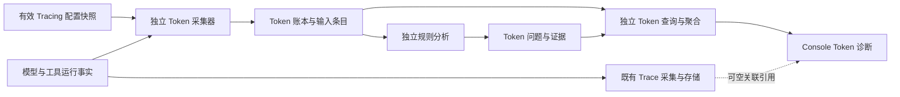

# Token 用量诊断详细设计

日期：2026-10-10

分支：`codex/token-usage-diagnostics`

基线：`99a2d861446a55415a9e54fb560f7895c1172a95`
状态：2026-10-11 已在该 worktree 实现；尚未提交、部署或执行业务数据库 DDL。下面保留设计边界，实际部署、分析窗口与适配器覆盖限制见 `docs/deploy/token-diagnostics.md`。

## 1. 已确认的功能范围

首期包含三步：保存每次模型调用的用量和输入来源明细；实现五类确定性诊断规则；按规则需要的单次调用或同一执行分支的调用序列生成问题、证据与改进建议。

- 使用者为 CoPaw 开发者，观察入口为 Trace 及其关联调用。
- 采集启用条件跟随现有 Tracing 的有效配置；Token 的身份、事件、持久化、分析和清理独立于 Trace 记录系统。
- Token 与 Trace 位于同一 MySQL database，使用独立表、连接池和事务；首期不增加独立 database 或实例的部署要求。
- 业务执行优先：Token 采集与落盘故障使用有界内存缓冲和重试，允许进程退出或资源限额造成数据缺口，不阻断 Agent。
- 规则对持久化的每次调用及执行事件后台增量分析，任务结束后校验最后的数据修订；不在模型调用线程中等待规则计算。
- 任务用量覆盖 Main Agent、SubAgent 与属于该任务的辅助模型调用。
- 诊断只新增数字、指纹和来源引用，不新增提示词、会话或工具结果原文存储。
- 各类 token 的估算与 Provider 报告的实际输入、输出分别保留。界面可按比例分摊实际输入，但必须显示近似标记；规则使用原始分类估算。
- 缺失用量、未完成调用、采集不完整不得表达成已确认的零消耗。
- 系统提供建议，开发者自行修改配置或代码。自动早停、内容裁剪、模型切换、缓存复用和优化效果实验均不属于首期。
- 不要求业务用户维护测试案例。开发过程仍需要验证采集、状态、计算、幂等与隔离的程序测试。
- 参考 dsh-context 的总量、分类、逐次调用趋势和展开明细，但沿用 `console/DESIGN.md` 的视觉规范。

## 2. 当前代码事实与约束

| 入口 | 已有行为 | 设计含义 |
| --- | --- | --- |
| `src/swe/token_usage/model_wrapper.py` | 收集模型响应用量，写入工作区日/模型汇总 | 保持现有汇总兼容；不能依靠它恢复历史输入条目 |
| `src/swe/agents/model_factory.py::_wrap_model_with_tracing` | 始终包装 TokenRecordingModelWrapper；TracingModelWrapper 按现有 Tracing 状态加载 | Token 诊断读取有效 Tracing 配置决定启用，但不以 TraceManager 就绪或成功创建 Span 为前提 |
| `src/swe/agents/model_factory.py::create_model_and_formatter` | RetryChatModel 在用量与 Trace 包装器外层 | 普通包装器可观察其显式重试尝试；Provider 内部隐藏重试仍需识别和披露覆盖范围 |
| `src/swe/tracing/model_wrapper.py` | 调用开始生成 Span；调用结束更新用量；缺失 usage 回落到 0 | 新诊断数据必须区分 reported、pending、unavailable 等状态 |
| 同文件 `_wrap_stream` | 正常流结束后收集末尾 usage；中断不保证进入正常结束路径 | 取消、异常与提前关闭必须有独立终态处理，不能伪造最终 usage |
| `src/swe/tracing/manager.py` | 内存批量队列、失败重排队；Trace 汇总由运行时累加 | 幂等和聚合不能依赖重复累加；该队列本身没有跨进程崩溃持久性 |
| `src/swe/tracing/store.py`、`scripts/sql/tracing_tables.sql` | MySQL 的 Trace/Span 表已有输入和输出字段 | 保留旧记录兼容；新诊断建立独立 Token 账本，不往 Trace 表增加诊断字段 |
| `src/swe/database/connection.py` | 事务和查询优先使用模块级 `_CURRENT_CONNECTION`，上下文未按连接池实例隔离 | TokenStore 只从自己的池取得连接、显式管理事务，不复用这套全局事务上下文 |
| `src/swe/app/runner/context_usage.py` | 会话状态保存前采集三大类下一轮上下文占用快照 | 不用于还原每次已发生的模型请求，不加入历史消耗汇总 |
| `src/swe/app/subagents/worker.py` | 独立子进程绑定租户上下文后运行；入口没有显式初始化现有 TraceManager | 子进程独立初始化和刷新 Token 采集器，继承启用配置快照，不要求初始化 TraceManager 才能写 Token |
| `src/swe/app/subagents/runtime.py` | 研究与终结均通过 SWEAgent 的模型，request_context 有 subagent_run_id | 建立分支身份，并把终结调用与研究调用分别标记 |
| `src/swe/agents/memory/reme_light_memory_manager.py` | 辅助流程可以创建携带 trace_context 的独立模型 | 为属于当前任务的辅助调用显式绑定身份，后台独立任务不得误挂 |
| `monitor/src/monitor/app/services/tracing/query_service.py` | 查询现有 MySQL Trace/Span | 诊断使用独立 Token 查询服务和接口，沿用访问范围语义，不借旧查询计算新账本 |

`CONTEXT.md` 与 ADR-0012 区分 Execution Trace ID、Agent Trace 和 B3 Trace ID。Token 系统使用自身任务、分支和调用身份；Execution Trace ID 和 Span ID 是可空的外部关联引用。B3 只用于分布式关联，不能用于合并不同执行尝试。source_id、tenant_id/user_id 与 Agent 身份分别传递，不把 source_id 当成所有逻辑租户的唯一身份。

## 3. 已确认的独立记录架构

用户选择采集跟随 Tracing，同时明确要求记录尽量独立、便于隔离。因此采用独立 Token 账本与采集器；共用有效启用配置，不共用 Trace 队列、Store、主键和事务。

- Token 使用自己的 task_run_id、branch_run_id、logical_call_id 和 call_id。只有存在合法关联时附加 Execution Trace ID/Span ID；Trace 写失败不阻止 Token 开始或结束记录。
- 新诊断数据库迁移、连接池、批量写入和失败处理独立。物理上采用同一 MySQL database 的独立 Token 表；模块读取既有数据库配置值建立自己的连接池，不使用 TraceStore 或 TraceManager 的连接对象。
- Trace 与 Token 分别消费同一次请求的运行事实；模型响应流只消费一次，两条采集旁路的写入异常分别隔离。两边各自幂等落盘。旧 Trace token 字段作为兼容统计保留，诊断实际用量以 Token 账本为准，不同步修改两边累计字段。
- Token 查询和规则只依赖 Token 数据。Trace 详情可以按关联引用展示 Token 面板；Trace 已清理时，Token 仍能独立查询自己的数字与证据。
- 与 Tracing 关闭时继续采集的方案不同：本次未选择独立启用策略。启用条件共享不意味着记录成功、数据保留或故障状态必须共享。

同库隔离属于模块、记录与连接池隔离，不承诺 MySQL 实例资源或基础设施故障隔离。Token 表迁移只创建 Token 自有结构；Token 清理只处理 Token 自有记录。访问控制仍由 source/租户范围决定，连接池独立不替代数据权限校验。

独立记录及业务优先的架构决策见 `docs/adr/0037-token-diagnostics-own-records-and-share-tracing-enablement.md`；领域用语见 `CONTEXT.md` 的 Token Diagnostic Run、Token Call Record、Token Finding 和 Token Capture Completeness。

## 4. 数据模型草案

### 4.1 调用账目

拟增加独立的 `swe_token_model_calls`。每次真实模型请求尝试拥有独立 call_id，作为调用账目主键。记录 Token 任务 ID、执行分支 ID、父分支 ID、调用用途、逻辑调用 ID、尝试序号、分支内调用序号、schema_version、数据修订号、用量状态和采集质量。完整租户与 Agent 范围随请求绑定；trace_id、trace_span_id 为可空关联字段。

拟增加 `swe_token_runs` 保存独立分支身份及分析进度。每项根请求创建自己的 task_run_id 和根 branch_run_id；每个子任务/辅助执行创建独立 branch_run_id，关联同一 task_run_id 和 parent_branch_run_id。一行对应一个分支，不把会话的多轮执行合并为一个任务。

Token 表不对 Trace/Span 表建立外键；开始、结束、幂等更新和统计不查询对应 Span 是否存在。

- 实际 input_tokens/output_tokens 独立可空，显式报告的 0 为有效值。
- 执行状态与用量状态独立：error/cancelled 不代表 usage 必然缺失。
- 缓存读写与 reasoning 只作为 Provider 子项记录；规范化时标明是否已经包含在总量中，禁止重复相加。
- 记录有效输入窗口与输出上限，便于历史规则使用当时配置。
- finish_reason 按规范化枚举保存，同时记录 Provider 原值的允许字段；原始正文不落入诊断数据。
- 启用前只有旧 Span 的记录显示 token_diagnostics_unavailable，不能从历史 0 推断 reported，也不伪造 Token 调用或输入来源。

### 4.2 输入条目

拟增加 `swe_token_input_items`。一行表示一个内容条目在某次请求中的一次出现，唯一键为 `(call_id, occurrence_index)`，其所属关系指向 Token 调用而不是 Span。

条目保存：调用与租户范围、类别、生产者类型、来源引用、原始内容身份、实际发送表示的指纹、保留字节数、estimated_tokens、计数器版本、是否裁剪、归因质量。工具结果来源关联工具调用身份，不只依赖工具名称。

分类目标为 system、tools、user、inject、skill、assistant、tool_result 和 unclassified。Skill、Hook 和摘要等来源应由生产者提供旁路标记；格式化之后不能仅根据 role 猜测。来源不明时进入 unclassified，不拆出看似精确的 Skill/注入分类。

指纹限定在租户内比较；优先采用带租户作用域的带密钥指纹，避免暴露可枚举的短文本。不同格式、完整结果与裁剪表示分别保留身份。辅助用途、计数器版本不同的调用不直接进入同一个增长比较序列。

每次请求另外保留整体输入估算与归因完整性。逐条估算之和不保证等于 Provider 实际值或整体序列化估算；协议开销、媒体未知等差异不得伪造成某个业务类别。环图比例分摊仅为展示派生值，不覆盖原始估算。

### 4.3 诊断结果

拟增加 `swe_token_findings`：规则 ID/版本、Token 任务 ID、分支、稳定的问题键、发现时的数据修订号、触发指标、阈值快照、关联 call_id/输入条目、证据质量、建议、状态和观测时间。Trace 引用只用于页面导航，不作为规则结果的唯一身份。

同一规则命中同一问题更新证据；问题键不含可变的调用次数。不同规则共用证据时保留关联，禁止把潜在节省直接相加。自动重算在目标修订上更新 active/resolved；后续调用数量变少或问题数变少不能直接解释为用户已经优化成功。

### 4.4 规则所需的执行事件

无效重试与压缩周期判断需要工具执行和压缩事实。独立的 `swe_token_execution_events` 仅记录这些规则所需事实：Token 任务/分支、生产者操作 ID、事件序号、工具及参数指纹、结果指纹或错误类型、轮询声明、进展/阶段版本和压缩周期。记录任务/分支开始结束等最小生命周期，支持独立统计完整性。

Token 采集器从运行时获得这些数字与指纹事件，不读取 Trace 原始输出或依赖 Trace 的工具 Span。输入中多次出现同一结果不产生多次工具执行事件。

### 4.5 表字段与约束

本版原列五张主表；后续 [观测底座 A](2026-10-12-token-diagnostics-observation-foundation-design.md) 增加六张类型化关系明细，共 11 张表构成一个 Token 记录域；不新增通用任务引擎或消息总线。

| 表 | 主要字段 | 幂等与访问索引 |
| --- | --- | --- |
| `swe_token_runs` | branch_run_id、task_run_id、parent_branch_run_id、source_id、tenant_id、user_id、agent_id、chat_id/session_id、trace_id、调用角色/用途、开始结束时间、execution_state、expected_attempt_count、已启动子分支身份集合、已知丢弃计数、capture_state、data_revision、analyzed_revision、analysis_state、各规则分析质量摘要、分析领取标识与租约期限、最近分析错误 | branch_run_id 唯一；`(source_id, tenant_id, started_at)`；`(source_id, tenant_id, task_run_id)`；`(source_id, tenant_id, trace_id)`；分析状态与租约索引 |
| `swe_token_model_calls` | call_id、任务/分支及完整访问范围、logical_call_id、attempt_no、logical_seq、trace_span_id、provider/model、有效窗口/输出上限、revision、执行/用量/采集状态、input/output tokens、Provider 可选用量子项、原始输入估算、计数器/指纹/适配器版本、结束原因、起止时间、预期和保存输入条目数 | call_id 唯一；`(branch_run_id, logical_seq, attempt_no)`；`(source_id, tenant_id, task_run_id)` |
| `swe_token_input_items` | call_id、occurrence_index、访问范围、category、producer_operation_id、source_type/source_ref、原始身份与发送表示的指纹、estimated_tokens、保留字节数、是否裁剪、归因/估算质量 | `(call_id, occurrence_index)` 唯一；`(source_id, tenant_id, call_id)`；任务/分支内来源与指纹查询索引 |
| `swe_token_execution_events` | event_id、任务/分支及访问范围、branch_event_seq、事件类型、producer_operation_id、父调用身份、规范化工具身份、参数/结果指纹、结果/错误枚举、轮询声明、阶段/进展版本、compaction_epoch、时间、revision | event_id 唯一；`(source_id, tenant_id, branch_run_id, branch_event_seq)`；操作 ID 索引 |
| `swe_token_findings` | finding_id、任务/分支及访问范围、rule_id/version、稳定 finding_key、observed_revision、指标/阈值快照、证据引用、证据等级、建议代码、自动观测状态、时间 | `(source_id, tenant_id, branch_run_id, rule_id, rule_version, finding_key)` 唯一；任务与状态索引 |

新执行身份独立生成；已知根执行使用 scoped AnswerTurn / cron 执行关联保持附着身份，具体以观测底座 A 为准；时间统一存 UTC，日期过滤和界面按调用方时区解释。计数字段使用 BIGINT，未知用量可空；不依赖旧 MySQL 版本可能忽略的 CHECK 约束，数据校验由写入 DTO 执行。状态枚举由应用约束，初始 DDL 按项目数据库规范使用类型化列与关系明细编写，不依赖 MySQL 8 专属领取语法。

内存证据对象只允许标识符、状态值、数字和安全元数据；数据库通过类型化列和引用明细持久化，不接收任意原始对象。Provider 子项只保存白名单数字，禁止将 raw response 整体 JSON 化落库。首期问题只有自动观测状态，不预留人工处理工作流的字段或写接口。

### 4.6 状态语义

| 维度 | 状态 | 含义 |
| --- | --- | --- |
| 调用执行 | prepared、running、completed、error、cancelled、abandoned | abandoned 表示超出所属执行预算后仍缺少终态；不能证明 Provider 请求没有发生 |
| 用量 | pending、reported、partial、unavailable | reported 允许显式 0；只有部分数字或累计片段时标 partial，不能当作最终准确用量 |
| 单次输入采集 | complete、partial、unavailable | 描述输入条目覆盖情况，独立于是否收到 Provider usage |
| 分支采集 | unverified、complete、incomplete | complete 只表示与已持久化的分支终态计数对账成功；不宣称排除了所有未观测内部重试 |
| 分析 | pending、running、ready、insufficient_evidence、failed | ready 表示在 analyzed_revision 上完成；若 data_revision 更大，仍有待分析变化 |

没有任何模型调用、且分支生命周期完整时，总量可以是明确的 0。仅因调用表里没有行不能推出 0。Traces 只有旧数据或整段 Token 记录从未保存时显示未取得诊断数据。

## 5. 请求采集与落盘边界

1. 根据任务开始时有效 Tracing 配置快照启用独立 Token 采集，并绑定自己的任务身份；启动 SubAgent 时传递同一任务归属、独立分支及配置快照。TraceManager 就绪状态或 Trace 创建结果不决定 Token 账目能否写入。进程内 ContextVar 不能替代跨进程传递。
2. 输入装配提供来源旁路标记。真实模型调用边界冻结请求的数字快照与指纹，不改变消息内容、工具顺序或请求参数。
3. 请求开始以独立 call_id 建立调用记录与输入条目。网络重试共享逻辑调用 ID，每次实际请求尝试拥有独立账目。Token 表内部一致性可以使用事务，但该事务不包含 Trace 表。
4. 正常/错误/取消/流提前关闭均走幂等结束处理。只记录真实取得的 usage；累计流片段不相加，末尾明确回传优先。
5. 明细与结束状态按照修订号写入。迟到开始事件不能把 terminal/reported 回退为 pending。
6. 调用、条目或执行事件在 Token 自有事务中持久化，并推进分支 data_revision；后台分析器据此领取任务。不要在模型请求等待或流输出过程中同步执行跨调用数据库分析。
7. 父 Main Agent 结束不冻结仍在运行的 SubAgent 用量；查询分别展示主执行状态与整个关联调用链的数据完整性。

### 5.1 生命周期与接入

- SWE 应用生命周期负责独立 Token 连接池和后台写入器；连接初始化失败时进入可重试降级状态，不让启动或执行依赖 TraceManager。
- 模型工厂接入独立的逻辑调用范围和尝试观察器。逻辑范围位于 RetryChatModel 外，尝试观察器位于其重试调用内；尝试数和用途通过 Token 自有上下文传递。原有 JSON 用量记录和 Trace 包装继续运行，但诊断不以它们的写入结果为前提。
- 首期 attempt 表示模型调用边界实际可观察的一次尝试。Provider/SDK 内部隐藏重试不能伪造逐次账目；记录采集适配器覆盖版本，并避免宣称覆盖未知内部请求。
- 响应流只有一个消费通道。Token 观察器边消费边读取允许的用量字段；逻辑范围在异常、取消和消费者关闭时终结仍未结束的尝试。实现必须验证上层 async generator 提前关闭能传递关闭事件，不能依赖 GC 才结算。
- 上游为系统、Skill、Hook、工具和摘要提供来源旁路标记；模型边界关联最终准备输入。无法证明精确来源的条目进入 unclassified，而不解析自然语言猜测身份。
- SubAgent 启动快照传递 Token 根任务、独立分支、配置版本和关联引用；子进程使用自己的采集器和小连接池，退出时有界刷新。诊断密钥和数据库凭据使用现有受控配置读取，不写入普通 launch spec 或工具请求。
- 标题、压缩与子任务终结等调用明确标记 purpose；不把不同用途的调用拼成同一个历史增长序列。独立后台流程没有当前任务身份时不得挂到最后一个活跃 Trace。

### 5.2 业务优先与有界缓冲

采集回调只产生不可变的数字快照和入队，不等待数据库或规则计算。进程内自有缓冲维护记录数量及编码载荷预算，并把活跃调用保留快照、待写和写入中的载荷一起纳入额度；额度不是进程 RSS 的精确上限。

建议初始工程参数：最多 1,000 个待交付记录组、编码载荷 16 MiB；单次输入条目最多 2,000 个，单组载荷最多 512 KiB；批次最多 64 组或 1 MiB，间隔 1 秒；单批数据库等待不超过 3 秒；失败退避最多 30 秒，未交付记录保留最多 60 秒；进程关闭刷新预算最多 3 秒。参数属于首轮工程配置，性能校验后可调整，不代表已测得性能。

- 单次条目超限时保留小型调用元数据与真实 usage，裁剪诊断条目并将 input_capture_state 标 partial；绝不裁剪传给模型的业务输入。
- 同一 call_id 的待写开始与结束可合并为最高 revision 的自包含快照，结束记录保留已采集的条目与预期计数。数据库已提交但客户端确认丢失时，原 ID 重试可安全重放。
- 入队超限或过期时优先丢弃明细载荷、保留可容纳的用量/缺口元数据；无容纳空间时允许丢整个诊断记录，记录进程级丢弃计数。新模型调用继续，不为等待缓冲空间而阻塞。
- 日志只包含诊断错误类型、统计数字和允许的身份，不含内容或凭据。若后续能够落盘则附带已知 gap；如果整个任务及 gap 也未落盘，只能从采集侧日志/指标观察，不承诺数据库能够还原或标出这段丢失。
- Token 内部批次事务只从 Token 自有连接池取得连接并显式 begin/commit/rollback；不得经过 `_CURRENT_CONNECTION` 这一共享事务上下文。事务失败回滚 Token 批次，与 Trace 状态无关。
- 本方案没有 Redis Stream、本地文件 outbox 或跨重启恢复保证。数据库长期不可用时出现持续缺口是已接受的降级行为。

写入器对记录使用 revision 门控；开始 revision 低于终态时不得回退。Token 分支终态的 expected_attempt_count、已启动子分支身份和已知丢弃计数用于独立对账；计数或子分支登记与明细不符时标 incomplete。若未取得终态计数则保持 unverified，不仅凭“所有已有行都是完成”判断完整。根任务只有自身与所有已声明后代分支对账成功才能展示观测链完整。

## 6. 五类规则的设计边界

| 规则 | 输入证据 | 判断与起始阈值示例 | 正常行为/证据不足 |
| --- | --- | --- | --- |
| 重复工具结果 | 同一来源及发送表示在多次输入中的出现 | 至少 3 次出现，首次后重复估算累计至少 8,000 token | 必要复核标记、结果版本变化；没有可靠来源时只能给低强度重复内容线索 |
| 重复注入 | 同一次调用中的相同内容与不同注入来源 | 额外副本合计估算至少 1,000 token | 不同请求共享固定前缀不算同次重复；语义相似不在首期 |
| 疑似无效重试 | 同工具、参数指纹、结果/错误变化和目的 | 连续至少 3 次同操作；结果未变；有明确进展信号时再判断无进展 | 轮询、分页、数据变化；缺少进展信号只报重复调用，不能报死循环 |
| 历史增长 | 同分支、同阶段、同压缩周期的在线历史估算 | 至少 4 次调用，增长至少 2 倍且至少 8,000 token | 起点为 0 时倍数不可用；无阶段身份只展示增长，不断言异常；模型/计数器切换须重建起点 |
| 输出预算风险 | 当时有效上限、真实输出、结束原因 | 90% 上限为预算提示；明确截断并发生补写时升级执行影响 | 没有上限或 finish_reason 时不臆断；取消/断流不归为长度截断；reasoning 不重复计数 |

上述数字为待真实运行校准的规则默认值，不能承诺通用有效率或固定节省比例。首期规则不调用 LLM，不自动停止执行。未覆盖的原则作为开发者机会建议，不能伪造自动检测能力。

分析必须遵守时间与因果范围：分支内顺序用于跨调用比较，并发兄弟分支只汇总成本，不强行排成一个逻辑序列。缺失用量与明细过期、采集不完整是不同状态。

### 6.1 计算口径与规则输出

- 重复工具结果按可靠 producer/source 身份关联，统计不同 logical_call_id 的实际保留表示；网络重试尝试不当成新的 Agent 分析步骤。重复量为首次逻辑调用之后的估算贡献之和。裁剪表示按当时保留量计，不使用原始文件大小。
- 重复注入按一次 call_id 内内容指纹精确匹配，额外副本贡献为重复量。当前内容角色不同不自动排除重复；来源目的声明为必要复用时降级为可解释的正常行为。模糊语义重复不在本期。
- 工具重试统计不同 producer_operation_id 的真实工具执行，不把同一工具结果在输入中出现多次当成工具执行。参数对象键可规范化，数组顺序/类型/分页参数保留。轮询声明显式排除；缺少进展信号只报重复调用，不能判定死循环。
- 历史增长比较同一分支、purpose、明确阶段、model、估算器和 compaction_epoch 下的逻辑调用；起点大于 0 才计算倍数。没有明确阶段时仅给增长观察，证据不支持“异常”结论。使用已保存原始历史分类估算，不用环图分摊值。
- 输出预算风险依赖当时有效输出上限；达到 90% 可给预算提示。只有显式长度结束原因和明确的后续补写身份/关联才给“截断影响执行”。缺少补写或结束原因时降低证据强度，不用字符串相似猜测补写。

规则输出包含事实、推断等级、建议代码和证据引用；阈值与 rule_version 固定在结果中。首期提供版本化默认规则，不新增任意脚本规则、LLM 分析或规则管理 DSL。影响量可以排序，但不把高消耗直接解释为错误，也不把关联量当作已确认节省。

### 6.2 后台增量分析与多实例

分析器在 Monitor 独立 Token 服务中运行，从 `swe_token_runs` 扫描 data_revision 超过 analyzed_revision 的分支，默认每 2 秒扫描一批最多 50 个分支。这个时效是健康状态下的调度目标，不是数据库故障时的承诺。

每次采用带 claim_token 和 lease_until 的条件 UPDATE 领取分支，初始租约 30 秒；不依赖进程锁、Trace 生命周期或 MySQL 8 的 SKIP LOCKED。分析较长时续约；租约丢失的 worker 不再提交结果。

读取分支的目标 revision 及相应调用/事件一致性快照，执行单次和序列规则；同一 Token 事务校验领取标识、写入幂等 findings 并推进 analyzed_revision。分析过程中出现新数据时保留下一轮待分析，不能把新 revision 标成已分析。任务/子任务结束事件也推进 revision，迟到 usage 可触发重新计算。

规则服务只读取已提交 Token 记录，不再次构建 Agent、执行 Hook、调用工具或访问模型。规则失败保存安全错误码并退避，页面显示 failed/stale；不能返回“0 个问题”掩盖失败。准备输入尚未取得终态时，只执行证据足够的输入规则，用量/输出规则等待所需字段。每种规则分别返回 evaluated/insufficient_evidence 及缺失字段；部分规则证据不足时，页面仍展示其他规则的有效问题，并说明覆盖不足。

## 7. 查询与界面

Monitor 新增独立 Token 查询服务和诊断投影，旧 Trace API 及旧统计字段保持兼容。Token 接口按自己的任务/call_id 查询，不要求 Trace 行存在；按 trace_id 查询是经过权限校验的关联过滤。新投影分别返回已知实际总量、完成/未知调用数、采集质量、原始分类估算、派生展示比例和规则分析状态。

- Trace 列表显示已知总量、完整性标记、分类概览与疑点数。
- Trace 详情顺序为实际总量和输入/输出、类别说明、执行分支与逐次调用、问题与证据。
- 环图中心使用完整实际总量；不完整时标记已知部分，不显示完整精确总量。
- 类型展开显示数字、来源引用与指纹，不跳过原有权限检查读取原文。
- 规则未运行、运行失败、无命中、证据不足分别展示；没有问题行不等于分析成功且无问题。
- 所有查询、详情关联及指纹匹配依据服务端允许的 source/租户范围，不能仅信任客户端传入的 trace_id。

### 7.1 独立接口草案

Monitor 路由以 `/api/token-diagnostics` 为前缀，Console 通过现有 Monitor 地址映射请求 `/monitor/token-diagnostics/...`，不把接口放在旧 TraceStore/TracingQueryService 中。

| 接口 | 请求与返回 |
| --- | --- |
| `GET /runs` | 按允许 source/tenant 范围、日期、模型、用量/分析状态筛选；返回根任务概览和稳定分页游标 |
| `GET /runs/{task_run_id}` | 根任务与分支、已知实际总量、完整性、分类估算、分析 revision 和问题摘要 |
| `GET /runs/{task_run_id}/calls` | 按 branch_run_id 过滤调用；各分支按 logical_seq/attempt_no 排序，并发分支不伪造全局因果顺序 |
| `GET /calls/{call_id}/inputs` | 类别筛选、来源条目、估算数值与质量、指纹版本；分页结果不是完整分类总量的替代 |
| `GET /runs/{task_run_id}/findings` | 规则与状态筛选，返回指标、证据 ID 和建议，不返回原文 |
| `GET /by-trace/{trace_id}` | 受访问范围约束的 Token 根任务关联查询；不需要 Trace 表存在 |

首期接口只读。分析自动运行，无需页面按钮启动；首期不做人工处理状态编辑工作流或公开重算接口。

响应包含 `known_input_tokens`、`known_output_tokens`、`known_total_tokens`、`observed_call_count`、`reported_call_count`、`partial_call_count`、`unknown_call_count`、`capture_state`、`data_revision`、`analyzed_revision` 和 `analysis_state`。未知子项返回 null，不在序列化时转换为 0。未关联、未采集、采集中、旧数据、明细过期使用不同 available/reason 状态。

传入 ID 必须与服务器允许的 source/tenant/agent 范围匹配，权限边界内找不到记录返回 404，不能先暴露其他范围的存在性。数据库不可用返回 503；合法范围内只有旧 Trace 而没有 Token 数据返回 available=false，不返回假零。沿用既有网关认证和允许来源解析，不新增依赖调用方可任意声明范围的公开数据接口。

### 7.2 页面与交互

新增 `/analytics/token-diagnostics` 独立页面及 `console/src/api/modules/tokenDiagnostics.ts`、类型与专属控制器。旧 Trace 页面仅增加“Token 诊断”关联入口，进入自己的 task_run_id 页面；无关联时展示未取得诊断数据，不改写旧 Trace 的数值与请求契约。

页面固定顺序：任务/Trace 引用列表及已知总量 → 所选任务的分支、实际输入/输出 → 类型说明和来源条目 → 逐次调用趋势 → 规则问题与动作。缺失 Trace 行仍可显示 Token 元数据；任务名称来自已有受控任务元数据，不能为了显示名称新增原始用户问题存储。

完整且已上报的实际用量可用于环图中心；只有有效且完整可比较的输入估算才按比例锚定实际输入，标记“≈”。估算不完整或媒体未知时使用输入/输出总量图，分类显示已知估算，不把未知部分硬分摊。图表与列表共用一套类别值；输出和缓存/推理子项不重复计数。

运行中或分析未追上 data_revision 时进行有界刷新；离开页面取消请求，旧 task_run_id 的响应不得覆盖新选择。查询错误、无数据、无问题、证据不足、分析失败和过期均可见。遵循 Console 浅色管理规范，不复制参考项目的深色背景或新增主题体系。

## 8. 汇总、迁移与存储成本

Token 调用明细是诊断用量事实来源，Token 任务总量是可重建投影。Trace 页面显示的是关联 Token 投影，不重写既有 Trace 总量。重复上报、后台重算、父子任务关联不得通过再次 `+=` 修改累计值。分支状态尚未终结或存在缺失调用时，投影保留完整性信息。

迁移先创建独立 Token 表，再部署写入，最后启用诊断查询；旧数据没有 Token 账目时显示 unavailable。Token 有自己的清理策略，不随 Trace 保留期或 Trace 删除联动。Token 输入明细、调用账目和诊断证据的保留策略必须相互一致，清理后展示 expired，不当作采集错误。停用 Token 写入和回滚诊断版本不要求变更既有 Trace 表或停止 Tracing。

逐次请求保存完整条目会产生随在线历史增长的写入量。需测量平均条目数、每次采集耗时及数据库写入量，再确定保留期和批量阈值；限制触发时必须显式降低采集质量，不能默默漏条目后仍报告完整。

首期 Token 自有保留期默认 30 天，通过 Token 配置单独管理，不动态跟随 Trace 保留期。实际计费/长期经营统计仍沿用既有统计需求；Token 明细不承诺永久保存。按 Token 根任务终态时间判断清理，同一根任务的调用、条目、执行事件和问题一起在有界批次中清理，不逐步抹去仍需分析的证据。

清理只处理所有已登记分支结束且没有有效分析租约的任务，单批最多 100 个根任务；结束状态缺失的残留项使用当时执行超时预算与宽限期判 abandoned 后再进入保留期，不无限积压，也不把预算未知项假定为正常完成。清理与分析使用相同领取条件，不能并发删除正在分析的任务。

诊断新表迁移以独立 `scripts/sql/token_diagnostics_tables.sql` 和部署说明交付，不修改 `tracing_tables.sql` 去要求旧版本重建 Trace 表。SWE 和 Monitor 的部署配置指向同一 database，分别创建 Token 专用小连接池，建议每进程 1–2 个连接；SubAgent 进程也受独立池上限约束。多进程总连接预算必须结合已配置并发验证，不能按单进程数值误认为全集群额度。

指纹使用单独的部署密钥与 key_version，各参与进程读取同一受控版本；原文按统一格式在内存内计算摘要后丢弃。密钥缺失或无法匹配时仍采集实际用量与可用估算，但指纹相关规则显示 insufficient_evidence；不使用临时进程随机密钥制造无法跨进程比较的伪完整指纹。轮换版本不跨版本强行比较。

## 9. 验收场景

- reported=0、usage 缺失、未完成和 legacy 分别呈现。
- 流正常结束、无 usage、主动取消、异常、消费者提前关闭均有可解释状态。
- 重试尝试记录不遗漏也不重复；缓存/推理子项不重复计入总量。
- 同一调用结束重复提交、迟到开始和修订重放不改变正确账目。
- Main Agent、子进程 SubAgent 研究/终结、压缩/标题等辅助调用归属清楚，父子汇总只计一次。
- 同次重复注入与跨次固定前缀复用分开；轮询与普通重复失败分开。
- 增长比较在压缩周期/分支/模型变化处重置；指纹和估算来源可追溯。
- 跨 source 与逻辑租户查询无法泄漏；无来源分类不得冒充精细分类。
- 分析失败、证据不足与无命中分开，规则结果按修订幂等更新。
- 数据库故障或采集限制符合最终选定交付保证，并真实暴露缺口。
- Tracing 配置关闭时不启用新诊断；配置开启但 Trace 创建/落盘失败时，Token 可用自己的身份独立采集。
- Token 写入失败不阻断 Trace；Trace 写入失败不阻断 Token；两个存储事务和重试队列互不依赖。
- Trace 被清理后 Token 自有记录仍可查询；Token 清理不删除 Trace。
- 同一 MySQL database 内，Token 与 Trace 使用不同连接池和事务；停用任一写入组件不使另一个组件依赖其初始化结果。
- 在旧 DatabaseConnection 事务上下文内触发 Token 写入，必须使用 Token 自有连接；旧事务回滚不能撤销已提交 Token 数据。
- 缓冲额度计入活跃快照与写入载荷；超限、过期和关闭预算到期不会阻塞模型，已知丢弃真实记数。
- 数据库确认丢失后重放最高修订不重复插入输入条目或重复计费；完全未保存数据不宣称可恢复。
- 多 Monitor 实例抢同一分支只有有效 lease 持有者能提交；迟到 worker 不覆盖更新后的分析结果。
- data_revision 在分析中继续推进时，结果只覆盖目标修订，新数据保持待分析。
- 指纹缺失/轮换、媒体估算未知和来源无法识别时显示正确数据质量；不硬造类别和证据。
- Trace 或 Provider 内部隐藏重试不作为诊断完整性已验证的条件；业务测试案例与程序边界测试分开。

## 10. 澄清状态

已确认：

- 启用条件跟随现有 Tracing 的有效配置。
- Token 拥有自己的记录身份、采集器、存储、分析、查询与清理链路。
- 物理上同一 MySQL database，独立 Token 表和连接池。
- 采集故障业务优先，有界内存缓冲和重试，允许数据缺口，不要求跨重启恢复。
- 根据已经确定的“对每次调用应用规则”，采用持久化后后台增量分析，结束/迟到数据推进修订后再次校验，不同步阻塞模型执行。

没有剩余必须由用户选择的产品分叉。具体工程默认值、接口、字段和模块划分为本设计的拟实施选择，需用户审阅设计后再进入实施计划；本轮不提交生产实现。

## 11. 实现责任划分草案

| 文件或目录 | 责任 |
| --- | --- |
| `src/swe/token_diagnostics/models.py`、`context.py`、`config.py` | Token 自有身份、事件 DTO、状态、配置快照，不导入 TraceManager/TraceStore |
| `src/swe/token_diagnostics/usage.py`、`input_capture.py`、`provenance.py` | Provider 数字规范化、实际准备输入估算、来源映射和租户内指纹 |
| `src/swe/token_diagnostics/model_observer.py`、`collector.py` | 逻辑调用与尝试生命周期、流关闭和有界入队，不运行规则或等待数据库 |
| `src/swe/token_diagnostics/store.py`、`writer.py` | 自有池/事务、修订门控、批次写入、限额和失败统计 |
| `src/swe/agents/model_factory.py`、`react_agent.py` 及来源生产者 | 旁路接入 Token 上下文和准备输入来源；保持消息、工具可用性和旧观测语义 |
| `src/swe/app/_app.py`、`runner/runner.py`、`subagents/worker.py`、`subagents/runtime.py` | 应用/任务/子进程的独立初始化、身份传播、用途与有界退出 |
| `monitor/src/monitor/app/services/token_diagnostics/` 与 `rules/` 子目录 | 独立 Token 查询、分析租约和五种纯规则，不从 TracingQueryService 读取原文；算法只在 Monitor 维护一份 |
| `monitor/src/monitor/app/models/token_diagnostics.py`、`routers/token_diagnostics.py` | 查询 DTO、输入验证与允许范围校验 |
| `console/src/pages/Analytics/TokenDiagnostics/` 与独立 API 模块 | 总量、分类、调用与问题的页面及请求状态管理 |
| `scripts/sql/token_diagnostics_tables.sql`、部署文档 | 独立新表、索引、版本与回滚要求 |

`monitor/pyproject.toml` 的独立包不依赖 SWE；规则实现全部归 Monitor，不能为运行规则引入整个 Agent/Provider 栈。SWE 与 Monitor 通过版本化的 Token 表/数字事件协议协作，两侧 DTO 使用一致协议样例验证，算法不复制。跨库独立部署、任意规则扩展平台和重构既有巨型 Trace 查询服务不在本期。
