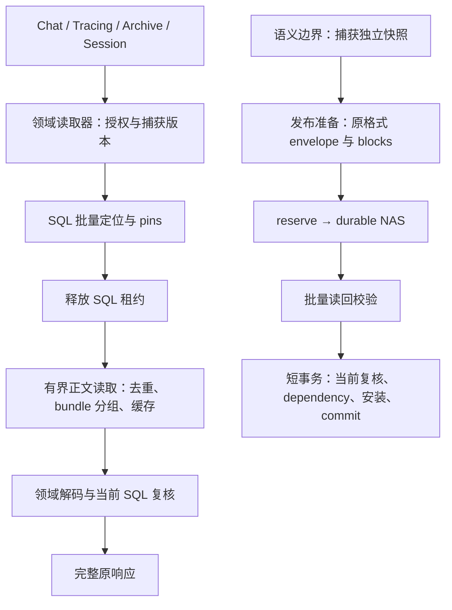

# 会话存储 SQL、NAS 与写入准备成本设计

日期：2026-11-05。分析基线：`f66a603ba`，工作区 `.worktrees/conversation-mysql-nas`。

状态：工作包 A（路由去重复 hydrate）已实现，见[实现报告](../reports/2026-11-05-conversation-single-hydrate-implementation.md)。其余工作包仍为设计，未连接业务 MySQL 或 NAS。第 2 节保留分析基线的成本清单。

## 1. 目标、范围与继承约束

本设计细化[整体性能重整方案](2026-11-04-conversation-storage-performance-redesign.md)的三个部分：批量 locator/引用校验/pin/dependency；消除重复 hydrate、同 bundle 批量读及有界缓存/背压；减少写入准备中的重复复制、编解码和正文读取。

继续遵守用户已确认的约束：

- 不增改表、列、索引，不改变 bundle、projection envelope、commit plan 的持久化格式和版本。
- 兼容已有数组、页码、cursor、完整 metadata 和详情成功响应；内部批量处理不得变成静默截断或只返回尾页。
- MySQL 仍是 Conversation Metadata 的权威；NAS 保存 Conversation Content。Session Execution Authority、当前授权、可见性、revision 和发布状态不交给缓存判断。
- locator 选择与 reader pin 同事务；NAS 等待不占 SQL 事务/连接；所有真实 worker 排空后才释放 pin 或宣告 writer 已停止。
- durable NAS 在前，MySQL commit 发布可见性在后；unknown commit 先对账，不重放模型和工具。原语义边界、fsync、backup fence、GC 保护不弱化。
- 本轮列表不要求并发更新下稳定翻页，不代表放弃正文、执行、删除、reset、GC 的并发正确性。
- 暂无业务 SLO。先以成本计数和正确性验收，再用专用 MySQL/NAS 确定参数与生产容量。

全文的 Occurrence 指独立的 Conversation Message Occurrence。相同 `Msg.id`、相同正文甚至相同 locator，都不能擅自合并业务 occurrence；只去重物理读和 ID 校验。

## 2. 当前入口与可核对的成本

以下行号对应分析基线。它们说明实际控制流，不等于生产耗时排名。

| 场景 | 当前入口 | 已确认的成本 |
| --- | --- | --- |
| Chat 详情/归档 | `runner/api.py:get_chat:1767`、`get_chat_history_page:1660` → `mgr.get_chat` → `HistoryStore` | 路由先完整 metadata hydrate，reader 又 hydrate 同一 Chat；重复 SQL、pin 和 metadata 正文读取 |
| Tracing 详情/归档 | `routers/tracing.py:_target_chat:153` → `get_chat` → `history.current/archive_page` | 同样重复 hydrate；目标用户/scope 的授权语义必须保留 |
| 正文读取 | `history.py:_payloads:366`、`chat_repository.py:_hydrate:147`、`source_messages.py:snapshot_sources:194` | 逐 extent 调用 `read_extent`，同 publication 多正文未合并文件访问 |
| Bundle IO | `bundle.py:inspect:368`、`iter_extent:439`、`read_extent:473` | 每个 extent 先 inspect 打开一次，再打开读正文；路径遍历、fstat、索引解码重复 |
| Projection 引用捕获 | `projection_references.py:_snapshot_rows:108` | 逐 Message/Turn 点查，重复 ref 还可能重复查询 |
| 提交最终复核 | `ProjectionReferences.revalidate:52`、`SourceMessages.revalidate:62`、`lock_publications:97` | 逐引用 SQL；两类 snapshot 对同一个 Message 的复核可能重叠 |
| 持久化前归属检查 | `publications.py:_validate_plan_reference_ownership:308` | source/prune/share proof 的 Message 和 publication 逐 ID 点查；reserve/write/commit 的不同阶段还需重新确认 |
| Reader pin | `retention.py:pin:317` | publication 已批量锁定，但成员逐行 INSERT，随后核对完整集合 |
| Dependency | `retention.py:add_dependencies:392` | publication 锁已分批，dependency 成员仍逐行 INSERT；成员校验一次返回整个集合 |
| Message 安装 | `message_installs.py:install_messages:225` | 在已锁定 Session/Chat 内，逐条 INSERT；并不需要用每条 lastrowid 参与本循环 |
| 全量接口复核 | `history.py:_revalidate_rows:306`、`chat_repository.py:_revalidate:216` | 单次无界 `IN`，pin 已分批并未解决这个查询/返回数组的容量 |
| 写入准备 | `runner_integration.py:root_provider:189` → `semantic_runtime.py:_root:79/_publish:107` | root provider、publisher、previous 等位置重复 deepcopy；全状态比较仍随状态增长 |
| Projection 生成 | `session_adapter.py:_save_state:327` → `projection_publication.py:prepare_recovery_blocks:131` → `session_projection.py:project_state:50` | 先完整 JSON 编码 root，再解码并 deepcopy、重新编码 projection/delta |
| 复用旧正文 | `_existing:70`、`_frozen_turns:241`、`removed_occurrences:468` | 冷路径逐正文读取；Turn 逐个 pin/inspect/read；同一发布过程中旧 recovery root 可能重复读 |
| Projection 缓存 | `projection_cache.py`、`refresh_projection_cache:294` | 已有 request/execution-local、revision-scoped 缓存；只有一个 key 不等于字节有界，读写都 deepcopy；提交后为每个新 block 反查 Message |
| Projection hydration | `snapshot_projection:154`、`hydrate_projection:261` | snapshot 内做一次完整 hydrate 校验，恢复调用又 hydrate 一次；校验与最终物化可共用一次结果 |

### 2.1 两个可判定的例子

**Pin SQL 模型。** 单个非空批次 P 个唯一 publication，当前 pin 的业务命令为 `1 次锁查询 + P 次 INSERT + 1 次成员校验`。P=4096 时为 4098 条，尚不含 BEGIN/COMMIT、连接探活/归还检查及 release。采用现有 PreparedInsert 的 100 行批次，在不另拆两个查询、且未触及字节/packet 上限的条件下，变为 `1 + 1 次数据库时间查询 + 41 + 1 = 44` 条执行命令；已有同阶段数据库时间时可少一次查询，冷 prepared 形状仍有 prepare/close 成本。成员行数和索引/redo 工作仍是 P。

**本地 BundleStore 调用实验。** 对真实 BundleStore，在临时本地目录发布同一 bundle 后逐 extent 读取，记录现有 inspect 和 `_open` 调用：

| 请求 extent 数 | inspect 次数 | bundle 文件打开次数 | 返回正文总字节 |
| ---: | ---: | ---: | ---: |
| 1 | 1 | 2 | 40 |
| 64 | 64 | 128 | 2560 |
| 256 | 256 | 512 | 10240 |

统计不包含预先 publish；`_open` 每次还会调用安全路径遍历。实验使用项目虚拟环境及 `PYTHONPATH=src:tests/fakes`（trace_sdk 使用仓库测试替身），未 mock BundleStore，也未访问 NAS/MySQL。这是调用次数证据，不能用它推算现场加速倍数。

## 3. 方案比较与推荐

| 路线 | 收益 | 代价/限制 | 选择 |
| --- | --- | --- | --- |
| 在现有调用方逐处加 cache/gather | 少量热路径可能受益 | 冷路径 N+1 保留；同事务不能并发 SQL；全局资源与取消保护容易分散 | 不采用为主线 |
| 保留领域读取器，集中批量引用处理、bundle 读取和发布准备 | 冷路径即可降低 SQL/文件访问次数；授权、发布语义仍由原领域负责 | 需明确共享数据和资源生命周期，逐工作包验证 | 推荐 |
| 重构存储格式、异步落盘、预计算持久化副本 | 可能获得更大幅度收益 | 超出 schema/format 约束，并改变 durable/恢复协议 | 不进入本轮 |

不建立覆盖全部实体的通用 Repository 或 DAG 调度框架。增加的内部类型只服务于已有复用场景：有界 ID 批次、明确的 locator 读请求、一次发布的准备结果。各领域继续负责自己的身份、内容和错误校验。



## 4. SQL：按集合批量化，按阶段重新验证

### 4.1 有界 ID 查询

新增小型批次 helper，负责正整数校验、去重、排序、行数/参数字节切分。实体 SQL 留在原模块或少量固定模板中，不接受任意表名、列名或锁语句字符串。

- 第一次读取收集唯一 Message/Turn/publication ID，各自批量查询；返回 `id → row`。逐原始 ref 执行现有归属和 locator 比较，不因 ID 去重丢弃相互冲突的 ref。
- 始终有 service/scope 约束，验证 Session 关联。ID 集合必须精确匹配：缺项、错服务单元、错 Session 都失败；不得把缺项当缓存命中或空正文。
- 读取列包含原比较字段的并集。Projection 和 archive source 对同一 Message 要求的字段不同，最终复核合并查询时必须保留两套检查的并集，不能只取较短的一套。
- 锁定读与普通读显式区分。原本在提交事务中的 `FOR SHARE/UPDATE`、generation/CAS 校验保留；普通 SELECT 不自动获得最终权威性。
- 所有独立批次在同一个 task、同一个短 SQL 阶段顺序执行；必要时使用现有 `db.acquire()` 复用租约。不得将事务绑定连接传到 `gather` 子任务，也不得跨 NAS 阶段持有租约。
- 在同一阶段消除重复查询；reserve、写入前检查和 commit 是不同阶段，不能用“刚才查过”跳过之后的权威检查。
- 全量旧接口的 `_revalidate_rows/_revalidate` 也必须分批，不能只修 projection。仍完整遍历所有预期行，不能加 LIMIT 后返回部分成功。

不能把原单语句集合复核简单拆成多个 autocommit SELECT：那样每批可能看到不同数据库时点。读接口 NAS 完成后的全量复核采用一个独立、无 NAS 的短只读一致快照事务，显式 REPEATABLE READ + consistent snapshot；在其中重新检查捕获的 Chat/Session 身份与原比较字段，并完成所有批次，之后保留原有需要的当前 head/授权复核。任何依赖 head 版本覆盖成员变化的简化，都必须先证明所有相关写入口同步推进版本。

当前 `DatabaseConnection.transaction()` 尚未暴露事务参数，不能假定默认隔离级别满足要求。B1 若采用该读取模式，须补充受控只读事务入口、禁止嵌入已有写事务，验证退出后的会话 baseline 恢复；不能将包含 pin INSERT 或 FOR SHARE/UPDATE 的事务标成 READ ONLY。提交内部的最终复核继续原当前锁定读，不改为这类只读快照。

同样盘点 `history._snapshot` 的 anchor source key IN、answer-turn、share selection/proof、archive/prune 的集合查询与更新。已有限制的集合也应受参数字节预算；UPDATE 的多个批次必须保持原外层原子事务。不是所有参数都是整数 ID，source key 的 UTF-8/二进制字节开销单独计费。

批次数 Bselect 与 pin 的 4096 上限不是同一概念。首个实验以 SELECT 256 IDs、现有 PreparedInsert 100 rows/256 KiB 为起点，对比 SELECT 64/128/256/512；packet、SQL 字节和超大单行另受约束。它们是待压测的工程起点，不是已确认的生产最优值。

### 4.2 保留锁协议，不在本包引入共享 guard

事务内合并锁集合并保持原有实体顺序；在每一实体阶段，全 ID 集合先去重排序、再切批，不能每个调用方独立排序后交错加锁。source/current publication 联合锁定包含本次 current，统一验证旧依赖 `< current.id`。

ORDER BY 和应用排序不能单独证明数据库实际锁顺序：执行计划和扫描范围也会影响锁，参见 [MySQL 官方锁定读说明](https://docs.oracle.com/cd/E17952_01/mysql-8.0-en/innodb-locks-set.html)。本包不承诺消除死锁；真实多连接测试及 EXPLAIN 是批量锁替换的验收门槛。不能为追求一条 SQL 将当前读改成普通快照读；既有 backup fence 和 guard 排他规则保持。

### 4.3 pin 与 dependency 成员批量写入

复用 `src/swe/database/prepared.py` 的 PreparedInsert 和 `insert_prepared`，采用模块级固定模板：

1. reader/backup/dependency 普通成员采用固定列，参数中提供 active 等固定值；保留数据库 UTC 时间语义，可在同一事务先取得一次数据库时间，再用于所有批次，不能悄悄切成应用服务器时钟。现有 PreparedInsert 的 row_template 仅支持占位符，不可直接塞入 UTC_TIMESTAMP 表达式。
2. 保留 `ON DUPLICATE KEY UPDATE` 的幂等语义，不能重新激活 released tombstone；不能以 INSERT IGNORE 或 affected_rows 判断集合正确。
3. guard/fence 的特殊行形状不强行并入普通模板，避免破坏唯一 marker 和 snapshot_ref 校验。
4. 所有批次在原外层事务内；中间批失败必须回滚，不能提交部分成员。复用现有 prepared 路径对出错 session 的隔离逻辑。
5. pin 仍先锁 publication、验证 committed/live，然后插入并精确复核成员；单批 4096、ReaderPins 多批生命周期不变。
6. dependency 仍锁定 source 和全部 older targets，再安装成员；大集合的最终成员复核改为按 `(service_unit_key, retention_key, member_key)` keyset 有界读取，核对缺项、额外项、kind、scope、state、guard_marker。不能仅按预期 ID 的 IN 过滤，否则会漏掉额外成员。
7. 有界查询/返回数组降低单条命令容量，不代表 dependency 整个原子事务只有 O(B) 个锁；总锁和成员行数仍随 P 增长。

同一个 commit 中 source 锁与 add_dependencies 的再次锁定可在后续子步骤消重：仅接受由当前 task/当前事务产生的内部锁结果，且有效期止于该事务。没有这个明确约束前，先保留重复锁，不能传入裸 rows 当作已锁证明。

### 4.4 Message 安装与提交后映射

在既有 Session/Chat 锁下按原 messages 顺序分配 session_order/archive_order，先生成全部待插入行，再用 PreparedInsert 分批 INSERT。保持空集合、混合 archive/online、context_epoch、source occurrence、prune 和 history_high/revision 的原语义。

不依赖连续自增 ID、不从 lastrowid 推算范围。需要供 projection cache 使用的新 Message ID，按本次 publication/session 及已知 order 范围批量查询，核对完整结果后建立 `block/locator → occurrence` 映射。涉及同 locator 多 occurrence 时保留列表和原顺序，不用字典覆盖。

`refresh_projection_cache` 使用安装后精确映射，避免逐 block 查 Message；`removed_occurrences` 的旧同 publication 引用也按 publication 范围批取后映射。仅取目标 publication 的窄列；无适配索引的组合查询需记录扫描成本，不构造无界 OR。

## 5. 正文：一次领域读取，一批 bundle 访问

### 5.1 消除路由前置重复 hydrate

MySQL history 分支先判断 indexed reader，再直接调用 `current/archive_page`，将授权回调传给 reader。reader 仍按原时点读取完整 metadata、执行授权、组装并最终复核。文件后端保持旧 mgr 路径。

Tracing 拆开“解析目标 workspace + 构造原授权规则”和“获取完整 Chat”。indexed 分支由目标 scope 的 reader 执行完整读取和授权；文件分支仍获取 ChatSpec。保留目标 user/source/agent 约束、未授权隐藏、404/503/422 映射，以及之前恢复的完整 memory/task/error/anchor 和审批语义。

若授权依赖历史 NAS metadata，仍在 reader 内执行必要 hydrate；目标是一次必要读取，而不是将未知授权字段省略或默认允许。该步骤无须新 HTTP 接口。

### 5.2 BundleStore 增加有界批量读取

保留现有 read_extent/iter_extent 兼容入口，增加内部 `read_extents`：一个 worker 在一个安全打开的 fd 上完成 header/index 校验和一组必要 extent 读取。

输入：可信相对 path、预期文件长度、去重后的 extent 列表、单次总字节/extent 数预算；需要独立 block kind/name 的消费者额外提出该约束。输入不会携带 SQL 权威或自行 pin。

内部要求：

- 保留基于目录 fd 的安全路径访问、O_NOFOLLOW、regular-file、格式/版本、完整索引和文件长度校验。解析和读取使用同一个 fd，读完前不外泄 fd。
- 每个 extent 必须满足当前 iter_extent 的 payload block 包含关系；原调用方要求更强的 exact block/kind 时继续验证。去重和合并不能允许越界范围。
- 首版只去重完全相同 extent，按 offset 排序 seek/read，结果映射回调用顺序。保持有界总返回字节；不为几个 block 读完整 bundle。
- 单次 `read_extent` 的 MAX_READ_BYTES 与已有流式大内容契约保留。大组按字节/数量切窗；单个超限对象不靠加大批次偷偷绕过原限制。
- 首版不读 extent 间无关间隙。未来若合并临近范围，需另测 seek/read 成本、过读字节、cache 计费和 block 验证，不能先假定总有收益。
- 一个 `(bundle, 有界窗口)` 目标是一次安全打开和至多一次 index 解码；大请求多窗口会有多次打开，不承诺整次全量请求永远只 open 一次。

### 5.3 请求内复用与物化

增加内部正文读取上下文，输入是领域已授权、已 pin 的 locator。它只负责去重、按 bundle 分组、预算、调度和只读字节返回；业务字段验证留在 History/Archive/Projection/Share。

- 缓存键至少包含物理存储身份、scope_kind、service/scope、publication ID、operation/path、预期 bundle 长度、offset/length。不能只按 Chat ID、Msg.id 或文件名缓存。
- 元数据正文、message、projection envelope/Turn 可共用读上下文，但响应顺序和各自 decoder 保持。相同 locator 的物理读可共享，每个 occurrence 仍单独参与业务身份/顺序验证。
- 缓存首先存不可变 bytes 和不可变索引表示；不共享可被调用方修改的 dict、Msg、ChatSpec 或审批叠加结果。现有 frozen dataclass 的 dict 成员仍可变，需要冻结或隔离副本。
- 请求上下文也有字节预算；超项不缓存，后续需要时可重读。不能以“只活一个请求”认定内存有界。
- projection 在同一调用中只物化一次：snapshot 负责引用定位/正文校验，完整 envelope 校验和 hydrate 返回一个明确结果给消费者。只验证不消费的 commit 路径不重复构建整份 state；校验规则与完整 hydrate 必须同源并做行为等价测试。

旧 current/full 最终响应数组仍有 O(R) 内存下界。批次和缓存预算不能解决无限响应的问题；总体容量准入与新分页 API 属于独立决策，本包不静默改变现有成功响应。

## 6. 缓存：有界且可失效，不成为权威

顺序：先完成请求内去重和冷读批量化，再增加进程内原始正文/索引 LRU；不增加 Redis 和跨实例失效协议。

### 6.1 预算与命中规则

- 每进程共享总预算，子配额区分 index、raw body、execution-local occurrence 映射及在途读。不能每租户/每 workspace 创建一份无总量约束缓存。
- LRU 同时限制字节、entry 数和单项大小；只读 bytes 按真实长度计费，索引/映射按保守对象开销加上字符串/locator 长度计费，辅以 RSS 峰值验收。字节预算不声称精确 Python heap 上限。
- 超大项绕过缓存，仍按正常有界/流式路径读取。驱逐和 cache miss 不改变业务结果。
- 同 key 在途合并在授权/pin 之后进行。各等待者保留自己的当前授权、版本复核和 pin；共享 worker 持有独立生命周期，任一等待者取消都不能取消他人读取或提前释放保护。
- 首个实现不强制跨请求 single-flight：LRU 足够独立验收后再加入。否则会一次性引入缓存、跨请求 worker 和 pin 所有权三种变更。
- 正常命中仍重新执行当前 SQL 定位/授权/版本/publication live 检查，并遵循现有 pin 协议。本包不新增“cache hit 免 pin”路径。
- cache miss 的失败不写负缓存；正文/格式错误不记作成功值；取消时 worker 即便最终读完，也不允许错误或半截数据入缓存。

### 6.2 Execution-local projection 映射

保留现有 revision-scoped exact-match 语义，改为有字节上限的 occurrence 映射。key 加入完整可信执行身份和 storage 身份，不能被另一个 Session/租户使用。

相同 canonical body 对应多个 occurrence 时使用按序队列，遵循现有 canonical 编码语义；不引入内容哈希或新的持久化指纹。改成共享不可变表示后减少 remember/cached 的整表 deepcopy，但每次消费队列仍独立，不得 pop 掉其他调用者的状态。

映射因容量不足可整体跳过，走 cold 批量读取，不对部分丢失映射伪装完整命中。后续若支持部分命中，必须显式区分缺失与已知不存在，并在 NAS 预算中如实计费。

### 6.3 物理完整性与离线验证

在线 warm cache 证明的是此前读取过的已验证不可变内容，不证明当前 NAS 文件仍在或介质正常；同长度静默损坏也不属于现有无 checksum 协议保证。冷启动/目标存储验证必须绕过正文和索引缓存。

迁移、备份恢复验收及完整目标 NAS 校验强制使用 cold mode/新进程；不能由全局 LRU 返回旧 bytes 冒充目标文件验证。GC/删除后的缓存驱逐用于释放内存，当前 SQL 检查负责禁止错误返回，不依赖所有 Pod 及时驱逐。

## 7. NAS 背压与资源生命周期

目前 PinBatch.read 和 PublicationStore._nas_io 都使用默认 `asyncio.to_thread`。新增一个由 ConversationRuntime/app lifespan 持有的 NAS IO 调度器，workspace、session adapter、shares 共用进程总量；直接 CLI/离线执行使用显式有界生命周期，不通过每个 BundleStore 创建 executor。

### 7.1 受限资源

- 专用 ThreadPoolExecutor，限制实际 running worker；提交前的有界队列限制 task 数和预计字节。仅设 executor.max_workers 不足以限制待执行队列。
- 区分读取、durable 写入、后台复制/GC；在线/后台各有并发上限和可用配额，避免后台把全部 worker 占满。读写共用受控总量，不增加不计总量的池。
- `submit` 之前必须取得 admission，不能先创建几千个 task 再让它们等 semaphore。大请求按窗口逐批生产，不保存无界待办数组。
- 在 SQL snapshot/pin 前取得有界读预算，避免请求全部 pin 后才无界排队；遇到 locator 长度未知先保守预留一个窗口，无法容纳时按现有快照重新规划/更小窗口，不在持有 SQL 锁时等待队列。
- 冷 miss 的任务在取得预算后才能提交 worker；pure cache hit 仍做 SQL/pin 校验，但不占 NAS worker。缓存 miss 的二次确认与预算获取之间不持缓存全局锁。
- 写入预算包括本次实际编码 blocks 长度及在途结果；已 reserve 后若调度失败，保留原 operation 的 prepared/unknown 状态并走既有收敛路径，不自动生成新 operation。
- IO 字节配额不能限制入队前已经构造的全部快照。写入准备还需要进程级并发/单次容量准入，在重度复制和编码前取得额度；等待不得占用 SQL 事务。该额度只约束优化链路新增的暂存对象，原运行中 Agent state 和完整 HTTP 响应的内存下界须另计，不宣称单靠 NAS 队列即可限制进程总 RSS。
- 队列满、开始前 deadline 到期明确失败；已经开始的 NAS 调用必须 drain，不能把 async timeout 解释为物理读写已经停止。

### 7.2 取消状态机

| 状态 | 取消处理 |
| --- | --- |
| 仅等待 admission，尚未 pin/提交 | 移除等待，释放预算，不执行 IO |
| 已 pin、已入有界队列但尚未运行 | 只有调度器原子确认未启动并移除任务，才能排空/释放 pins；与开始竞态时按已运行处理 |
| read worker 已运行 | shield 等实际 worker 结束，清理并释放 pins，再传播取消 |
| write/fsync worker 已运行 | 等 worker 结束，仍按原 operation 进入 unknown/reconcile 语义，不提前宣告已停止 |
| 多 worker 中一个失败 | 停止提交新的窗口，排空所有已启动 worker；全部清理后报告原错误，不能提前释放其他组引用 |

Python executor 的运行中 future 不能通过 `cancel_futures` 中止；参见[官方 executor 生命周期说明](https://docs.python.org/3/library/concurrent.futures.html#concurrent.futures.Executor.shutdown)。线程无法可靠打断挂死的文件系统调用，本设计只限制被占资源总量和新增准入，不承诺硬超时恢复。

停机顺序必须纳入 `_app.py` 生命周期：拒绝新增 → 停止生产者/后台 → drain NAS workers → 释放 pins/完成必要对账 → 关闭 SQL → 清理 executor/cache。当前 `reset_runtime()` 只清引用，需要新增显式 async close，不能仅在数据库已关闭后尝试释放引用。

控制请求的 SQL 连接预留/deadline 属于另一个工作包，但 NAS 背压上线验收必须包含 renew/Stop 的混合负载；不能认为新线程池本身就保障它们。

## 8. 写入准备：只捕获必要副本，保持 durable 读回

### 8.1 明确对象所有权

目标链路：

```text
mutation lock 下捕获 detached 完整状态
  → 一份私有发布快照 + 未知模块保留
  → 直接构造原版本 projection envelope/delta/Turn blocks
  → 按原调用方顺序绑定 reserve / 已有 prepared operation
  → 最终编码与发布前容量检查 / durable NAS
  → 从 durable bundle 有界批量读回并验证
  → 当前 SQL 复核、安装、commit
  → 接受已提交状态并更新 request-local 映射
```

“一份快照”是消除 prepare 链路中重复整棵树复制的目标，不保证底层 Agent.state_dict 或其他业务必须保留的副本消失。先检查 state_dict 是否全部 detached；不能仅因返回 dict 就把可变 Agent 内存借给 worker。

该图描述数据所有权，不统一改写所有入口的 reserve 次序：admission 等入口可能已经持有 prepared operation，首次 Session 的内部身份也须经原事务创建/确认。能提前确定的结构容量应在 reserve 前预检；依赖绑定上下文的最终校验在 NAS 写前完成。不得为了直接 state 准备而重排既有准入、generation 或 unknown 提交协议。

- 新增内部 prepared recovery 结果，拥有 detached state、原格式 envelope/blocks、occurrence 对照和编码字节。它是内存对象，不写进 plan 或 bundle 的新字段。
- legacy/internal 原 `write_bundle(blocks)` 继续可用。已知运行时入口使用直接 state 准备入口，避免 `_save_state` 完整 dumps → `prepare_recovery_blocks` loads 的中间大字节串；旧入口仍解码后汇入同一准备逻辑。
- `project_state` 在明确私有对象上工作：只重建已投影的容器骨架，未知模块从已 detached 快照保留。marks、重复 occurrence、task/error 和未知字段的 shape 不变；不能借机丢弃未知模块或只持久化 memory。
- previous 比较使用未被任何后续处理修改的独立快照/只读视图，去掉 revision 后继续完整比较；接受后的可写 execution state 与 previous 不得共享可写子节点。不能以未经覆盖的 dirty 标志代替全模块变化检测，也不引入内容 checksum。
- 对 Agent hook/并行工具的序列化仍由既有 mutation lock 保证。移出事件循环的 CPU 工作只能接收已 detached 的纯数据；不在 worker 中读 Agent 对象，不复用 SQL ContextVar/task-owned 连接。
- 大 JSON 的 worker offload 需实测 event-loop lag 和 CPU；线程并不保证 Python CPU 操作获得并行加速，不在本轮引入进程池。

### 8.2 旧内容与新 block 各读取一次

- `_existing`、`_frozen_turns`、`removed_occurrences` 共用一次发布内的 locator/body 上下文；已有 bytes/canonical 表示只计算必要次数，不反复 dumps/loads。
- 冷执行仍需读取已保留正文进行精确匹配，这个下界没有被缓存取消。将逐 Turn 的 SQL/pin/inspect/read 合并为有界集合，但每个 Turn 的状态、question key、Session 和独立 block 校验保留。
- 新 delta 在 `effective_recovery_plan` 和 `snapshot_projection` 间可共用“本次已从 durable bundle 读回并验证”的 bytes，避免再读一次。只有本次准备的内存 bytes 不能作为该证据；本次新 publication 首次 durable 校验绕过可能由准备阶段填入的全局缓存，只有真正读回成功的值可进入该校验上下文。
- 原 recovery root 用于 prune 比较的捕获身份包含 publication、offset/length 和 base revision；提交前的当前 Session/revision/CAS 仍独立检查。
- `refresh_projection_cache` 批量复用安装映射，不额外逐项反查和再次打开 index。

### 8.3 首版保留的工作

保留 publish 后文件/目录 durability 确认和 commit 阶段 durable bundle 校验，正常路径与新进程 reconcile 使用同源验证规则。首版只合并物理访问、共享本次已读回结果；不允许仅凭内存 PreparedPublication 跳过读回。

如后续实测读回仍是主要瓶颈，再单独设计“正常写入无需读回”协议及失败证据。当前没有足够证据把该优化与本包合并。

持久化格式包含完整引用列表，CPU 比较、envelope 大小和 dependency 成员仍有 O(A/P) 下界；本包不能承诺每次发布只随新增正文 Δ 增长。effective plan、compact、envelope/index/bundle 的容量正确性属于既定前置约束，性能优化不得扩大可写不可读范围。

## 9. 分工作包实施和退出条件

| 顺序 | 工作包 | 主要文件 | 独立退出条件 |
| --- | --- | --- | --- |
| A | 成本计数与去重复 hydrate | runner/api、routers/tracing、history、相关 route tests | indexed 详情/归档一次必要 Chat metadata hydrate；相同响应和错误映射；文件后端不回退 |
| B1 | locator/引用的有界批量 SELECT 与最终复核 | projection_references、source_messages、publications、publication_associations、history、chat_repository，及受控数据库只读事务入口 | SQL 执行数随批数增长；无无界 IN；跨批一致性、baseline、同字段/缺项/错 scope/并发语义保持 |
| B2 | pin/dependency/Message 批量 INSERT 与映射 | retention、message_installs、projection cache refresh | 原子回滚、幂等成员集合、tombstone、精确 occurrence 映射；真实驱动批量命令验证 |
| C1 | 安全 read_extents 与请求内分组 | bundle、history、archive_reader、projection、session、shares | 冷读取同窗口减少 open/index；无页外读取；所有错误和取消路径保留 |
| C2 | 进程 NAS 背压与生命周期 | runtime、factory、PinBatch、PublicationStore、app lifespan、后台适配 | worker/队列/字节总量有界；shutdown 顺序、read/write 取消和慢 NAS 验收通过 |
| C3 | 有界 LRU 与 execution-local 映射 | 正文读取上下文、projection_cache | 冷/热结果相同，预算和驱逐可测，当前 SQL 不省略；离线验证强制 cold；single-flight 可另包 |
| D | detached 快照与直接 projection 准备 | runner_integration、semantic_runtime、session_adapter、execution、archive_runtime、projection_publication/session_projection | 原格式恢复等价；整树复制/编码次数下降；unknown 重启恢复和语义边界不变 |

A、B 是首选起点；C1 与 B 逻辑独立但实现应分提交，C2 不得拖到最后。C3 在冷路径优化后实施；D 依赖准备/读取接口稳定及容量校验到位。每包先回归与复核，再进入下一包；本草案不是一次大改提交的授权或执行计划。

## 10. 验收矩阵

| 维度 | 必须覆盖 |
| --- | --- |
| SQL 批次 | 0/1/B−1/B/B+1、多批、4095/4096/4097/8193/16385；重复 ID 与冲突 ref；乱序返回、缺项、错 service/scope/Session |
| 成员安装 | 首批/中批/末批失败回滚；相同 key 幂等；不同集合/额外成员/released tombstone 拒绝；dependency older/source 检查与 GC 并发 |
| Message | 重复 Msg.id、同 locator 多 occurrence、混合 archive/online、源顺序、marks、context_epoch、高水位、terminal/admission 身份 |
| 批量正文 | 同 bundle/跨 bundle、多个窗口、重复 extent、零长度、8 MiB 边界、大对象流式；同 fd 校验、截断/坏索引/路径 symlink/不匹配长度/越界 |
| 兼容 | Chat/Tracing 当前与归档、answer-turn、完整 metadata、error/anchor/task、审批和隐藏上下文、target scope；旧列表数组/页码/cursor、分享与文件后端 |
| 快照 | 捕获后 append、reset/rebind/delete/active 更换、projection revision 变化、提交 generation 丢失；不能返回混合版本 |
| 缓存 | 全冷/全热/部分驱逐/超大绕过、相同 ID 不同 scope/storage、修改返回对象不污染缓存；warm hit 仍 current SQL/pin；GC 后不得读旧可见性 |
| 背压/取消 | admission 前取消、queued/start 竞态、重复取消、组内错误、多 worker drain；读期间 GC 不可 reclaim；writer IO 未完不能取得 stopped proof |
| 资源 | workspace/租户数增长不线性创建 executor/cache 配额；running/queued/bytes 峰值受限，慢任务不无限占用新增预算；停机时 SQL 仍可清理 pins |
| 写入正确性 | 未知模块变化、deepcopy 隔离、并行工具/流式重复 ID、prune/compact、semantic 工具与审批边界、unknown 重启对账、无缓存 commit 恢复 |
| 维护 | 新进程冷恢复、迁移源尾部/目标 NAS 完整验证、永久 share 独立存活、后台与在线混合负载 |

记录每请求业务 SQL、prepare/close、连接 acquire/ping/归还检查、返回/扫描行数、事务/锁时间、pin/dependency 成员行数、NAS open/inspect/fstat/read/write/fsync 与字节、队列等待/峰值、CPU deepcopy/JSON、RSS 和 event-loop lag。不得只比较总耗时或 cache hit ratio。

有代表性的成本断言：

- 同批 publication 的 pin 成员 INSERT 从 P 次变为按实际批次计数；不能用 mock executemany 假装一条 wire 命令。
- 一个预算内 bundle 读组至多一次安全文件打开和一次完整 index 解码；共享 locator 只进行一次物理读取，业务 occurrence 数不减少。
- indexed 详情/归档不在 reader 之前再次 hydrate；summary/context usage 既有零 NAS 成本保持。
- 直接 state 准备路径不产生“完整 root 编码后立即解析”往返；commit 仍验证 durable 文件，未知模块和恢复 state 等价。
- 批量化前后完整成功结果一致；任何异常/预算/取消不转成空数组、部分成功或模型继续推进。

真实 MySQL 验收使用专用库、多连接和现场锁定驱动版本；EXPLAIN 验证现有索引、扫描范围和锁行为。真实 NAS 冷/热、跨实例、慢 IO 与后台混合负载需单独执行。当前环境没有执行这些项目，不能给出确定吞吐、P95/P99 或加速倍数。

## 11. 范围外和下一步

本设计不改变 guard 为共享锁、不调整 schema/index、不增加内容哈希或持久化投影、不取消 fsync、不把正文写入改成 fire-and-forget、不新增全量响应的隐式截断。SQL 连接归还检查合并、renew 控制容量和 deadline 保留在独立工作包中；本包混合负载验收必须与它们衔接。

首批细化见[单次 hydrate 实施计划](../plans/2026-11-05-conversation-single-hydrate-plan.md)与[引用批量化详细设计](2026-11-05-conversation-reference-batching-design.md)。后者将 B1 拆为原事务内的引用查询 B1a、全量接口一致性和联合锁 B1b；它们尚未实现。B2/C1 各自独立设计和提交；资源参数使用受限初值做专用环境测量后确定，不把全套缓存/背压/写入改造塞进第一版实现。

设计阶段的文档检查与实现阶段的验证分别记录；工作包 A 的运行时改动和测试证据见实现报告，不能外推为其余工作包或真实 MySQL/NAS 验收。

相关约束：[元数据/正文 ADR](../../adr/0038-conversation-metadata-in-mysql-content-on-nas.md)、[发布边界 ADR](../../adr/0039-conversation-publication-uses-mysql-commit.md)、[连续停机迁移 ADR](../../adr/0045-conversation-migration-uses-one-continuous-outage.md)、[checkpoint 已完成修复](../reports/2026-11-05-checkpoint-read-contracts-implementation.md)。
