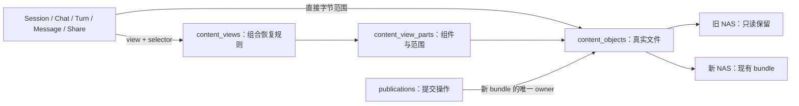

# 会话内容定位与数据库结构调整草案

日期：2026-11-06。状态：设计草案，未改表、未实施运行时。承接[调整方案](2026-11-06-conversation-metadata-only-adjustment-design.md)的 P0，实际库证据见[结构审计](../reports/2026-11-06-conversation-database-schema-audit.md)。

本方案的三表优先建议已由[减少关联的反规范化草案](2026-11-06-conversation-denormalized-schema-design.md)替代：只新增 legacy_sources，组合成员清单内联，新 bundle 继续现有 Publication；Chat 增加小型同事务投影以减少摘要关联。以下保留结构审查依据和备选方案，不作为最新实施目标；三表均未创建。

## 1. 决策建议

**需要有边界的结构调整，不重做全部会话表。** 保留 Session、Chat、Turn、Message occurrence、Share 的领域模型与执行权协议；将内容文件定位从 Publication 操作中分离。新增三张表：content_objects、content_views、content_view_parts。根路径登记继续使用受信任、版本化部署配置，不额外增加 roots 表。

普通消息直接指向 object 的真实字节范围，不为每消息增加 content_ref 和 part 两行。只有跨文件恢复、归并/投影才能得到的内容使用 view + 显式 selector；多个消息、Turn 可以共享同一冻结 view。

这是对此前“优先不改 schema”的结论收敛：Chat 纯 SQL、已有列投影漏接可以不改表；复杂旧格式原位读取需要明确扩展 locator 契约，继续强求旧字段含义完全不变会产生伪路径、伪 offset 或永久依赖迁移日志的问题。本方案是结构变更提案，不是已经应用的新契约。

## 2. 为什么不能只改 format_key

- 当前 Publication 一次操作对应一个生成路径的 bundle，并绑定单一业务归属；路径还在服务内唯一。
- 同一旧文件可能被多类内容引用，组合恢复结果也可能来自多个文件，操作、物理文件和逻辑结果不是同一个身份。
- BundleStore 校验 bundle 头、index 与真实 block，普通 JSON/JSONL 无法直接通过。
- 现有 recovery、Turn 点查、projection、GC、backup 均依赖 publication + bundle extent，仅加一个格式值不会同步解决这些入口。
- 安装计划当前还放在 NAS import_plan block，需要独立 SQL-only 安装协议。

不采用把永久 descriptor 塞进 migration_entries、不以 JSON Pointer 冒充 offset、不伪造历史 admission/terminal publication，也不创建没有文件的空 bundle。

## 3. 模型与读取

统一的是应用读取协议，不要求每份正文都拥有独立 SQL ref 行。读取器先验证业务实体与 locator，批取对象/视图/成员，按文件分组读取，同一请求同一冻结 view 只重建一次，再执行 selector 和 occurrence/Turn 身份校验。

### 3.1 content_objects：一个真实文件

| 字段 | 类型/约束 | 语义 |
| --- | --- | --- |
| id | BIGINT UNSIGNED PK | 内部文件身份，不是消息身份 |
| service_unit_key | VARBINARY(256) NOT NULL | 所属存储服务 |
| root_key | VARBINARY(64) NOT NULL | 可信配置中的稳定根标识，不是任意绝对路径 |
| binding_version | BIGINT UNSIGNED NOT NULL | 绑定协议/恢复身份版本 |
| relative_path | VARBINARY(1024) NOT NULL | 真实相对路径，不加虚构后缀 |
| storage_class | ASCII VARCHAR(24) NOT NULL | legacy_readonly 或 managed_bundle |
| storage_format | VARBINARY(64) NOT NULL | 实际文件编码及版本 |
| byte_length | BIGINT UNSIGNED NOT NULL | 注册时已确认的真实文件大小 |
| sha256 | BINARY(32) NULL | 文件级校验证据；legacy 完整验收须具备，非跨租户去重键 |
| owner_publication_id | BIGINT UNSIGNED NULL，唯一 | managed bundle 的唯一操作 owner；legacy 为 NULL |
| durable_at | DATETIME(6) NOT NULL | 旧源确认或新文件持久化确认时间；两者语义由 class 区分 |
| created_at | DATETIME(6) NOT NULL | 登记时间 |

唯一键 `(service_unit_key,root_key,relative_path)`；同一 root 不允许原地替换内容或因 binding_version 变化重复登记同一路径。更换物理来源需要新的明确 root 身份。root 配置随业务恢复集合保留，启动核验 key/version/服务/授权路径，SQL 不能指定任意挂载位置。

managed 对象只在耐久确认后登记；prepared 操作仍可按 operation 的确定性路径对账未登记文件。登记与相应发布证据同事务安装。新 bundle 编码、NAS 写入顺序和取消 drain 协议保持。

本次 managed bundle 继续一 operation 一文件，不引入多个操作共享一个可回收文件。GC 权威仍在 Publication，object 不复制一套独立 gc_state；关联由 object.owner_publication_id 唯一维护，Publication 不再反向存一个可分叉的 bundle_object_id。

### 3.2 content_views：一个不可变逻辑恢复视图

字段：`id BIGINT PK`、service/scope_kind/tenant/source/agent、`session_id/chat_id NULL`、`view_key VARBINARY(64)`、`resolver_key VARBINARY(64)`、`descriptor_version INT`、`parameters_text TEXT`、`parameters_sha256 BINARY(32)`、`created_by_publication_id NULL`、`created_at`。

唯一 `(service_unit_key,view_key)`；索引 `(session_id,id)`、`(chat_id,id)`、`(created_by_publication_id)`。view_key 是稳定幂等身份，不按消息复制 view。内容冻结后不原地修改参数或成员，业务 head 改指新 view/extent。

parameters 仅保存 generation、epoch、watermark、恢复规则等有类型的小型元数据，应用上限 16 KiB；大范围组件列表放成员表，不放 JSON。禁止保存完整 root、消息、摘要和工具内容；禁止隐藏成员表未枚举的文件路径。参数版本和 resolver 共同定义含义。

### 3.3 content_view_parts：完整可枚举的文件依赖

字段：`view_id BIGINT`、`part_order INT UNSIGNED`、`object_id BIGINT`、`role_key VARBINARY(64)`、`byte_offset BIGINT NULL`、`byte_length BIGINT NULL`。主键 `(view_id,part_order)`，反向索引 `(object_id,view_id)`。

offset/length 同为空表示完整文件，否则均为真实字节范围。例如 journal 已提交前缀用 offset=0、length=committed_bytes，完整 object 仍记录包含未提交尾部的原文件大小及指纹。具体 watermark/epoch 保存在有版本参数中，不将“尾部存在”当成允许读取。

本次只支持 view→object，不增加递归 view→view 图。缺少原历史状态时拒绝或按已明确的旧接口缺失语义返回，不能靠新表拼造内容。

### 3.4 两种互斥 locator

| 分支 | object_id | offset/length | view_id | selector |
| --- | --- | --- | --- | --- |
| direct | 非 NULL | 均非 NULL，实际字节范围 | NULL | NULL |
| view | NULL | 均 NULL | 非 NULL | 有版本的显式选择条件，完整结果可为空 |

selector 是受限小对象，例如选择已存在的 question/runtime Turn 或层内某 occurrence；不是 offset，也不是任意代码。应用限制序列化字节并按 resolver schema 校验，不建立 selector 全文索引。所有入口共享同一个 locator 验证器，任何错配立即失败，不捕获异常后尝试另一分支。

文件共享不等于内容跨 scope 可见。先验证业务 owner，再验证 view/selector/对象和该 scope 的可信源映射；root 与 service 一致不替代权限验证。

## 4. 现有表逐项调整

| 表 | 保留 | 调整 |
| --- | --- | --- |
| sessions | 完整身份、generation/owner/lease、active Turn、revision/epoch/usage | 恢复头采用 recovery direct/view locator；SQL 控制字段覆盖冻结旧值 |
| chats | 外部 ID、标题、排序、专家专列及 CAS、历史/checkpoint head | 扩展无正文 meta 走已有 metadata_text；内容型快照保留显式 locator；checkpoint 内容头采用 direct/view，操作身份独立保留 |
| turns | question/runtime 幂等、顺序、执行状态与身份、admission/terminal 操作关系 | 增加一组当前完整 Turn 恢复 locator；现有读取只需要当前有效版本，暂不增加两套历史时点 locator。若样本/调用方证明需要不同内容，再扩展 |
| messages | occurrence ID、重复 source ID、顺序、可见性/epoch、Turn/archive 关系 | 正文使用 object_id + 现有真实 offset/length，或共享 view_id + selector；offset/length 对 view 分支可空。正文 publication 不再充当位置，操作来源另作明确 provenance |
| publications | operation、prepared/committed/aborted、代次、CAS、边界、未知提交及 managed GC | 路径/format/完整文件大小/耐久字段移交 object；archive/checkpoint/event 内容采用显式 locator，纯 SQL 导入操作可无 object |
| retentions | guard/fence、managed reader/backup/dependency 协议 | 保护目标继续明确关联 managed owner publication；增加安全清理设计，不能直接 TTL 删除反重放 tombstone |
| swe_chat_shares | 原 token/字段/独立生命周期/计数 | 服务归属与 snapshot direct/view locator；旧孤立分享不要求 Chat 存活 |
| migration jobs/entries | 作业门禁、ID 票据、无正文批次计划与对账 | 不承担永久 view/object 描述；清理 entries 不得破坏线上读取，ready authority 另有明确保留策略 |

新的 locator 列及反向索引需要一套最终 DDL 与 readiness，不在旧表随意堆可空字段并永久双读。若其他环境已写入旧 DB 模式数据，提供有版本的回填与互斥过渡；当前 copaw_dev 六表为空，可在停写复核后一次性对齐最终结构。三条原分享仍须保留并回填。

重要兼容修复：旧 Turn 可能没有历史 admission/terminal publication。当前 get_turn_state、materialize/latest 查询不能继续以 publication 非 NULL 作为“Turn 内容存在”的条件，必须按已准入状态和有效 locator 判定；不得伪造过去的提交事实。

## 5. 运行控制与生命周期

Chat 纯 SQL、context_usage 和冻结执行身份投影都是现有字段的接线问题，不新增通用 JSON 状态袋。Cron 投递回执属于任务执行/投递实体，先核对既有 owner；需要独立 receipt 表时单独给出有类型设计，不把它混入本次三张内容支撑表。

legacy_readonly 永不 unlink/chmod/rename，不因无 pin 或逻辑引用消失而回收。纯 legacy 读取可使用不写 SQL 的内存 IO 生命周期保护；仍做业务授权、版本及格式校验。混合读取枚举所有 managed owner，按现有 4096 单批限制分批 pin，所有实际 IO 排空后释放。

managed GC 继续由 operation tombstone 协调，但保护检查需覆盖 direct 业务根以及活跃 view 经 parts 的 managed 成员。不能把“view 行还存在”当永久 pin。提交新 view 指向 managed 对象时安装相应 publication 依赖，禁止向 deleting 对象新增引用。

released reader、reclaimed operation、旧 epoch/不可见 occurrence 都会积累。先定义重试窗口、活跃集合与最小反重放凭证，再给有界清理策略。当前不按时间分区，不全量 TTL 删 tombstone，也不为 schema 整齐重做租约表/分享计数表。

## 6. 性能与索引原则

- N 条普通消息只增加业务行上的 object_id，不额外增加 N ref + N part；object 数按文件增长，view/parts 按真实恢复组件增长。
- 列表/标题/普通属性不 JOIN 内容表，不读 NAS；列表展示白名单与扩展属性持久化验证分离。
- direct 批量解析业务 locator→objects；view 批取 view/parts/objects 后在请求内重建一次，不按每条 Turn/消息重读整个 ledger。
- 业务 locator 建 object/view 反向索引；只对实际保护查询需要的表增加，避免机械复制长 scope 索引。
- 保留现有身份、稳定顺序、分页索引；service-unit 改造是已确认的基线差异。无 user 的 scope 最近列表、混合方向 latest Chat、current 多 layer、GC 候选的索引由真实 SQL/基数 EXPLAIN 决定。
- 全文件 sha256 用于冻结/完整验收/恢复，正常读取不能为每条消息重算整文件摘要；按实际格式原有校验、范围和身份验证读取，不宣称可检测所有等长外部篡改。
- 无业务 SLO 时先给确定性成本：SQL 次数、返回/扫描、support 行数、NAS open/read/write、冷读字节、RSS 和事件循环延迟；不声称加速倍数。

## 7. 调整顺序及放行条件

1. 先用真实旧样本完成 direct/view 映射：UTF-8/重复 occurrence、Session v3 pending/ledger、checkpoint 多 epoch 和提交尾界、archive/share/孤立分享、旧 Turn 选择。
2. 冻结三表和业务 locator 的完整 DDL、索引、参数/selector schema、根配置版本。同步更新 schema_contract、预检及备份集合定义；不先让 DBA 执行旧版升级脚本再二次返工。
3. 实施 P1 纯 SQL 与投影漏接修复；新增内容 resolver，贯通打开旧 Session→新问答→混合历史→重启→reset/现有 compact；原 NAS 字节/路径/权限不变。
4. 实施 metadata-only SQL 安装/断点；完整 import/verify/finalize 后才能 ready。新增内容仍先耐久 NAS 后原子安装 SQL，纯元数据不走内容 publication。
5. 补齐 Turn/projection/Archive/checkpoint/share/GC 与取消；核验新 projection 协议引用 occurrence/Turn 和 locator，不再把旧 publication+extent 三元组当全部身份。旧 bundle 内旧 projection 保留解码兼容。
6. DBA 按最终版本预建/升级；最小 DML 账号、真实 NAS、旧分享、已有 workspace、跨实例及重启验收，再开放写入。

自研 backup/restore 仍是独立缺陷，但平台一致恢复集合必须包含这三表、业务表、根绑定和实际被引用旧/新文件闭包。已有 bundle-only backup 不得宣称支持新混合模式；不让迁移日志成为未备份的线上依赖。

本轮确认了结构调整方向和实际库差异；复杂旧样本解析与最终 DDL 尚未验收，不能直接据此改生产表。实施计划继续沿 P0→P1→P2→P3→P4→P5，结构冻结是 P0 的实际退出条件。
