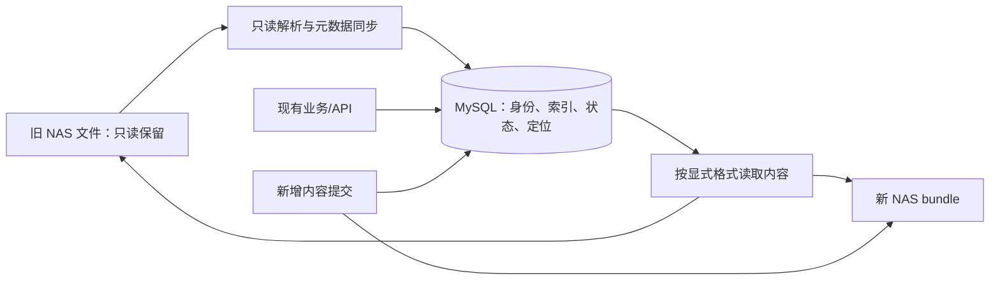

# 会话元数据纯同步：调整方案与分期计划

日期：2026-11-06。源码基准：`49a4222c8`，工作树 `.worktrees/conversation-mysql-nas`。
状态：设计草案，未实施。依据[目标对齐审查](../reports/2026-11-06-conversation-migration-goal-alignment-review.md)，本轮进一步核对旧格式组合恢复、SQL-only Chat 与迁移提交协议。

最新结构取舍见[减少关联与反规范化方案](2026-11-06-conversation-denormalized-schema-design.md)：三张内容支撑表收敛为仅描述旧内容的一张 legacy_sources，复用新 bundle 的现有发布机制，Chat 使用小型同事务投影减少列表关联。后文三表是前轮备选，不再作为默认实施方向。

后续 P0 结构复核见[内容定位三表方案](2026-11-06-conversation-content-schema-design.md)，[实际数据库审计](../reports/2026-11-06-conversation-database-schema-audit.md)确认 copaw_dev 六表缺 service-unit 字段、分享未扩展、迁移控制表缺失；六业务表为空，原分享有三条。当前建议保留业务模型，新增物理对象/组合视图/成员三表；普通消息直接 object+真实 extent，不能为每消息额外创建 ref+part。以下“是否需要 DDL”的门槛已收敛为明确的结构变更提案，最终字段与旧样本仍待冻结验收，未执行改表。

## 1. 目标、范围与必要澄清

交付目标：用户提前建表；工具只读旧 NAS，将元数据及内容定位同步到 MySQL；切换后数据库是元数据唯一权威，新增内容才写 NAS。旧文件内容、路径和权限均不由工具修改。工具不删除、重命名、修复、截尾、隔离或重新打包旧内容，也不在旧源树写断点、安装计划或报告。

旧文件中原有的元数据副本可以保留；运行时不再将其作为当前权威。新内容采用现有 immutable bundle，旧格式文件本身不改变。旧内容存在 NAS，不等于每次列表/改名都应访问 NAS。

沿用：既有 schema/索引优先、原 HTTP/API 成功语义兼容、单次停写切换、不做长期双向同步、不加入列表并发快照。Compact 算法/容量/错误终态及摘要组装继续延期；混合内容必须仍能运行现有 compact/reset 语义。

### 对上一轮结论的修正与补充

- `chat_repository.update_title` 已是纯 SQL。需要改造的是完整 Chat 创建/更新、扩展 meta 存储等仍走 `_publish_metadata` 的路径，不能笼统说所有改名都会写 NAS。
- Session v3 ledger、checkpoint journal v2 的恢复结果不一定原样存在于某个文件的连续字节中。不能把数组序号或 JSON Pointer 塞进 byte_offset，宣称只是换一个路径。
- 当前离线安装计划也在 bundle 的 `import_plan` block；取消正文复制时必须同时调整安装和断点协议。
- 已有 SQL 列不等于所有在线 writer 已接入。`context_usage_text` 当前只见导入写入；正常 Runner 保存到恢复 state 的快照尚未见对应 SQL 安装，需要补专项验证与实现。

## 2. 路线选择

| 路线 | 改造范围与成本 | 对目标的符合度 |
| --- | --- | --- |
| A：历史只读兼容读取，新写继续 bundle（推荐） | 增加格式分派、只读解析和纯 SQL 导入；复杂恢复需组合定位契约 | 满足不复制历史正文的目标，需先证明既有表能表达所有定位 |
| B：沿用重打包，仅去除额外原件副本 | 运行时变动较小，迁移仍会生成历史正文副本 | 只能满足不覆盖旧文件，不能满足只同步元数据，不作为默认路线 |

A 保留旧/新文件格式，但需要扩展应用层读取契约。**不预先承诺完全无需 DDL。** 现有表的物理结构、字段含义和应用读取协议是三件事；P0 必须逐格式给出可行性证明。若原有字段语义不够，输出最小契约/DDL 差异，再单独确认；不能静默改表、修改偏移语义或退回重打包。

## 3. 目标结构与读取规则

元数据查询直接访问 SQL。需要正文时才经内容定位层读取；定位层按数据库中明确的格式分派到现有 BundleStore 或只读 legacy resolver。数据库故障、定位错误、旧文件缺失不触发 legacy writer/fallback。

### 3.1 三类数据边界

| 类别 | 权威位置 | 本次处理 |
| --- | --- | --- |
| 身份/归属、标题、列表字段、排序、状态、epoch/revision、消息关系和定位、专家绑定 | SQL 专列；扩展 Chat meta 使用已存在的 metadata_text | 按现有行为补齐纯 SQL writer/reader |
| 消息、摘要、工具输入输出、技能/模型恢复快照 | 旧 NAS 文件或新 bundle | 保留内容，按需读取 |
| Cron 回执、幂等 key、计划/审批等控制信息 | 按所属实体逐项确定 | 已有专列则接入；独立任务系统保持独立；真正属于会话控制但无承载位置的字段列为 schema 冲突，不塞进不相干 JSON 列 |

Chat meta 的可持久化键与 summary 允许展示的键分开。`expert_main_binding` 仍由服务端专列重构；server-owned 键不因放开扩展 JSON 而开放客户端写权限。提示词/场景快照等兼容字段先按实际语义归类，不能再使用“未知键一律正文”的规则。

元数据容量先对现有样本做只读分布统计，再给出应用字节上限及超限清单；不能将 MEDIUMTEXT 理论容量当作 API 保证，也不能静默截断或转存 NAS。正式上线前必须处理全部历史超限对象，保持原接口返回值。

### 3.2 内容定位的两种契约

**物理 extent**：JSON 中真实存在的单个对象、JSONL 完整行、完整 snapshot 文件。记录受信任根、真实相对路径、格式、文件长度及真实 UTF-8 字节范围。重复消息 ID 仍按 occurrence 区分；原行不能假装已经是数组或 bundle block。

**组合恢复**：Session v3 root+ledger、checkpoint v2 head/record/segment/manifest/evidence/epochs。需要有版本的、无正文的组合描述，明确组成文件、generation、epoch/revision/watermark、committed_bytes 和完整性证据，由纯读算法重建。未提交尾部不进入可见历史；pending 不可通过写旧文件来恢复。

组合描述不是完整恢复 JSON，也不是消息/工具正文。现有 `result_metadata_text` 有 CommitPlan 契约，迁移 `details_text` 仅用于安装计划/进度；不能把它们当任意扩展槽。永久读取描述必须属于明确的业务元数据生命周期，并纳入一致备份集合，不能隐藏在不随业务备份的迁移日志中。

需在 P0 核对：publication path 唯一约束、scope/Session/Chat 归属、共享旧文件、单 Turn 恢复、projection 引用等能否表达。不能用伪造路径后缀绕过唯一约束。

### 3.3 恢复与续写

1. 从 SQL 获取当前 revision、epoch、状态和可见内容定位。
2. 只读加载对应冻结内容版本；SQL 中已有权威控制字段覆盖旧快照同名值，逐字段定义规则，不能整棵 state 盲目覆盖。
3. 已删除、已裁剪、已重置的消息不得因再次 materialize 旧 ledger 而复活。
4. 后续发生内容变化时，继续按现有 publication 协议写新 bundle、提交新索引/恢复根；不更新旧文件。
5. 成功切到新恢复根后不再重复合并旧 root/ledger。新 bundle 可引用仍可见的旧消息，所有引用解析统一支持两种格式。

仅元数据变化不生成新恢复内容；需要 Agent 恢复内容的写入仍应正常持久化，不能为减少 NAS 而丢状态。

### 3.4 生命周期与成本边界

- legacy 文件采用显式“外部只读、禁止物理回收”策略，不靠现有 GC 遇到路径异常来碰巧保护。新 bundle GC 保持原协议；组合读取保护完整组件集合。
- 旧内容在被 SQL 引用期间必须长期保留。删除旧目录属于将来单独的数据迁移，不包含在本工具中。
- 内容 resolver 保持 symlink/越界/错误 scope 拒绝，BundleStore 原路径验证不放宽。
- 一次请求按文件分组读取，避免每条消息重新全文件解析；JSONL 优先按 SQL 字节范围读取。迁移按文件扫描并复用解析结果，处理 Unicode 与嵌套 JSON 的真实字节定位。
- 首次大 JSON 解析仍可能昂贵；应记录冷读字节/耗时，不承诺所有旧格式都能随机读取。C1/C2/C3/D 后续按实际热点推进。
- 离线完整验证须真实读取，不以缓存或抽样替代。线上不能为每条消息重算整个源树摘要；完整指纹在冻结边界及完整验收时使用，在线按已确定的格式/组件完整性契约校验。

## 4. 纯 SQL 写入与导入提交

### 4.1 Chat

新建/更新直接在短 SQL 事务安装元数据，不创建空 publication、不 reserve、不写 `{}` bundle。`metadata_text` 支持已分类的扩展 meta；新行 `content_meta_*` 为 NULL。保留 summary 的展示白名单。

复用/提取现有创建、重绑、draft winner、删除墓碑、metadata_revision CAS 和专家绑定规则。锁顺序保持 backup fence/scope guard → Session 按 ID → Chat 按 ID，registry_order 分配及 draft_chat_id 更新与创建原子完成。

patch 在锁定的当前行上合并，避免改为 SQL 后仍用旧整份对象覆盖并发属性。旧完整 spec 接口不增加强制 revision 参数；不宣称原接口已有客户端端到端乐观锁。专家独立 binding_revision CAS 保留，Chat 执行状态继续由 active Turn 投影，不接受客户端 status 越权改变执行状态。

既有 DB 数据若还有 content_meta locator，先保留完整读兼容，再在停写边界回填到 SQL；按 revision 合并并清空 locator，不修改/删除原内容文件。未回填前不能宣称所有完整 Chat 读取零 NAS。

### 4.2 Session/Turn 投影补齐

在同一次有效 state/publication commit 中安装 context_usage SQL 快照，保留捕获失败“保旧值并标 invalid/stale”的语义及 revision 约束。核对专家执行身份冻结时点，接入已有 execution_identity_text；它只承载专用专家身份，不扩成任意控制 JSON。

Cron 回执单列检查：新 Session execution 是快照/CAS，旧调用方不能仅因方法签名相同就假定持锁执行等价。覆盖 uncertain 持久化、外部发送、完成提交、重入及重启；不能用事后 CAS 撤销已发送的消息。无现有列承载的会话控制字段属于 P0 退出条件。

### 4.3 只同步元数据的导入

复用 discovery 的身份映射、安全检查、稳定源键、SQL ID 票据及 journal，但不复用“先写 bundle 再读 import_plan”的提交链。

每批仅保存受限、无正文的 SQL 安装计划/对账证据：实体映射、定位、预期版本、批次边界和摘要。业务行写入与该批 committed 标记在同一事务完成；失败整批回滚。重试同一作业不重复实体或推进顺序；身份票据已分配但批次回滚可以安全复用。

输入内容改变、身份歧义、缺失组件、未知现存目标行均阻断；不猜测或覆盖。分批受行数、参数/字节和连接 packet 约束；不将整个导入包成一笔长期 SQL 事务。所有批次及完整验收完成前不产生 ready，业务实例不读取中间态。

复用 `conversation-storage` 命令组，提供显式 metadata-only 模式；新 manifest/receipt 有独立协议版本与模式。旧重打包作业不能被新模式续跑，新作业不能被旧程序当成已验证作业。旧命令不静默改变语义；提供明确互斥与错误提示。

`DMLDatabase.acquire/session` 接口缺口先独立修复，保留同物理连接、named lock、事务、packet 预算与受限 SQL；外层 ReadOnlyDatabase 不得获得写能力。

## 5. 实施分期与验收门槛

每期独立提交实现与回归；本文件为分期设计，逐期执行计划在该期契约稳定后细化。

| 阶段 | 主要交付 | 主要文件范围 | 验收/退出条件 |
| --- | --- | --- | --- |
| P0：定位及字段契约 | 全格式映射表、真实旧样本语义对照、SQL 字段归属表、最小 schema 冲突清单 | `migration/legacy.py`、`schema_contract.py`、SQL 文件；新增设计/样本测试方案 | Session v1/v2、v3 ledger、checkpoint v1/v2、archive、share 均可表达；有冲突先决策，不开始全量工具重写 |
| P1：现有表内独立修复 | Chat 纯 SQL、扩展 meta/summary 分离、context usage 投影、DML facade | `chat_mutations.py`、`chat_repository.py`、`session_adapter.py`、publication 安装、`runner_integration.py`、`migration/preflight.py` | NAS 方法全部抛错时纯元数据操作仍成功；draft/绑定/删除/fence/CAS 不变；正常执行后 SQL usage 可读；真实 facade 链可 verify/finalize |
| P2：旧内容只读访问 | 纯读 parser、按格式 resolver、根绑定与校验、最小打开→续写→重启链路 | 新增专用 legacy 内容解析/resolver；`factory.py`、`runtime.py`、`session_adapter.py`、`history.py`、`reference_queries.py` | 不调用可修复原件的旧 reader；源无写入；复杂 Session/多 epoch checkpoint 可完整恢复；不复活 SQL 已排除内容 |
| P3：元数据同步工具 | 新模式/版本、批量安装、SQL-only 断点和 receipt、完整验证 | `migration/discovery.py`、`inventory_v3.py`、`v3_manifest.py`、`journal.py`、`direct_import.py`、`install_records.py`、`verify.py`、CLI | 导入 NAS 写入为零；无安装计划 bundle；首/中/末批失败及断点续跑正确；源改变拒绝完成；完整覆盖后才 ready |
| P4：混合内容全入口 | Archive/checkpoint/Turn/projection/share、显式 legacy GC 策略、API 兼容 | `archive_reader.py`、`checkpoint_reader.py`、`source_messages.py`、`projection_references.py`、`shares.py`、`retention.py`、`gc.py` | 新 bundle 引用旧消息可读；旧文件不被 GC 删除；旧 token/孤立分享可读；reset/归档/compact 既有成功语义不变；Cron 兼容通过 |
| P5：真实验收与交付 | DML 账号、既有 workspace 启动、真实 NAS/实例验证、正式操作手册、平台恢复集合清单 | 集成测试、runbook、入口索引、SQL 交付说明 | 全链路 import/verify/finalize/启动成功；旧源路径/字节/权限不变；无模式混跑；未验项明确列出，不以单元测试代替 |

P0 先于任何复杂 locator 实现。P1 中已证明不需 DDL 的独立修复可先做；它们不等于整个纯同步目标已完成。P2 最小链路验证后再实施 P3，P4 补全全部引用入口，最后 P5 放行。

### 必测样本与故障

- UTF-8 多字节、嵌套/转义 JSON、重复 Msg ID 不同 occurrence；普通 Session JSON 与大于 8 MiB 的源文件。源文件总大小不等于单个运行时对象可以无限大，后者仍明确限额与报错。
- Session v3 已提交 ledger、pending 边界；checkpoint v2 多 epoch、committed_bytes 与未提交尾部；真正纯读且语义与旧正式读取结果一致。
- archive JSONL、旧 share snapshot、Chat 已删除后的孤立分享；内容型扩展 meta、server-owned 键、空/false、历史超限对象。
- 旧历史打开 → 新问答 → 混合分页 → 重启 → 改名/状态后旧 JSON 不覆盖 SQL；新 recovery 生效后不重复合并旧 ledger。
- 缺失/截断/越界/损坏/symlink/跨 scope、取消、提交结果未知、首中末批回滚及同作业重试。
- 新 bundle 依赖 legacy publication；运行中读保护与新文件 GC 保持，legacy 永不物理删除。
- 每个纯元数据入口记录 NAS open/read/write/inspect/pin，预期均无内容 IO；迁移记录写入为零，完整验证实际读回。记录 SQL 次数、扫描/返回、池等待、RSS 和冷读字节/耗时，不编造 P95 或吞吐 SLO。

## 6. 正式操作流程

1. DBA 使用最终版本 SQL 预建表并核对；迁移账号不授 DDL。首先 dry-run 预检和身份清单，确认全部服务/scope，控制文件放专用目录。
2. 停全部旧 writer、Cron、分享计数更新和 GC，建立冻结边界；优先运维只读挂载/视图，不 chmod 源树。不在工具中假装字符串凭证能停止进程。
3. 扫描会话相关根、必须配置和分享来源，生成版本化 inventory；不对无关模型/知识库/技能内容做全树摘要。保留发现新增/丢失业务文件及歧义身份的检查。
4. metadata-only apply 分批写 DB，可用同一作业 resume；中途不启动新版业务。旧源不创建任何新文件。
5. 正式 reader 完整语义验证并核验冻结源/原分享未变；DBA 按最终分享约束完成收紧，再 finalize 输出 ready 与 runtime 配置。
6. 配置稳定 service ID、scope、DB authority、旧根与新内容根；先启动新版一实例验证，随后扩容并开放写入。新内容根可在同一 NAS 卷上，但与受保护旧内容集合明确隔离。
7. 留存源清单、job/receipt、SQL 版本和验收报告。出现错误不得重新启用旧 writer；新增 DB 数据后按一致恢复点处理，不能直接重放停写前数据。

旧 staging/RENAME/v2 install 指南不得混用；发布手册统一维护一个主入口。本流程在 P0–P5 完成前只是设计，不能作为现成执行命令。

## 7. 备份、性能及范围控制

本项目现有 8 项 restore 失败仍是独立灾备缺陷，不是导入/verify/finalize/启动依赖。此次新旧混合内容必须提供平台备份的完整文件/描述依赖清单与一致边界；不要求为了交付同步工具先修完整自研 restore。若继续提供自研 backup/restore，则必须明确其是否支持混合格式，不能沿用 bundle-only 的成功承诺。

发布保护采用明确可用的一致备份/恢复流程，不能只备 MySQL 或只备新 bundles 而遗漏被引用的旧文件。永久 locator 元数据必须随业务集合保留，迁移日志不能成为遗漏的线上隐性依赖。

保留 SQL 单权威、scope、代次/CAS、耐久内容后发布索引、未知提交对账、pins/GC。C1 批读、C2 背压、C3 缓存、D 快照优化按实际 NAS 路径稳定后推进。Subagent per-run、trace store、Cron 任务定义等独立系统不自动扩为本次全部数据库化。

本轮只交付方案。下一实施入口应是 P0 的契约验证，P1 可独立分包；当前不能承诺直接修改导入器即可完成全量纯同步，也不能以修复既有 9 项失败替代新目标验收。
