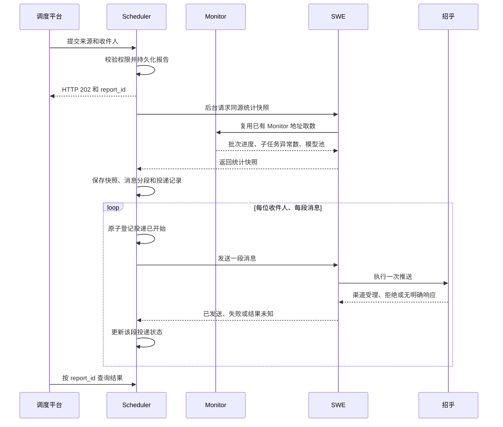

# 定时任务批调度简报详细设计

需求来源为 [定时任务批调度简报](../../features/2026-11-24-001-batch-dispatch-status-report.md)。以下接口、状态和表结构为拟新增契约。

## 1. 目标和服务职责

调度平台注册定时作业并传入固定的来源和收件人员工号。简报展示该来源当天可报告的全部新版批次，每批只有名称、状态、进度、失败统计和本批 Worker 占用。开头按模型池展示当前占用和有效容量。整批跳过的任务从批次总数和列表中剔除。招乎正文的子任务信息汇总到失败、部分成功、超时三项数量。

| 服务 | 负责事项 | 代码落点 |
| --- | --- | --- |
| 调度平台 | 注册发送时间、传入来源和收件人 | 参考 [当日失败补跑注册方式](../../integrations/cron-daily-failure-rerun.md) |
| Scheduler | 异步受理、报告与投递状态、模板和消息分段 | 新增报告路由和独立后台处理器，接入 `scheduler/src/scheduler/app/routers/__init__.py` 与 `scheduler/src/scheduler/app/_app.py` |
| Monitor | 按来源读取批次、子任务及模型池的一致快照 | 在 `monitor/src/monitor/app/services/cron/` 增加聚合查询，复用新版看板 SQL 和 Worker 在途口径 |
| SWE | 转发只读统计请求，读取来源默认 Agent 的招乎配置并投递 | 新增内部取数中转和投递入口，复用 Monitor 客户端及现有招乎渠道 |



## 2. 对接契约

### 2.1 平台受理接口

`POST /api/scheduler/cron/batch-status-reports`

```json
{
  "source_id": "RMASSIST",
  "recipient_ids": ["00001234", "00005678"]
}
```

- JSON 只接受上述两个必填字段。来源使用现有 Cron 身份字段的字符约束。收件人传 1–100 个员工号，按 8 位 ASCII 数字字符串校验并保留前导零，排序和去重后落库。
- Scheduler 将受理时刻以 UTC 保存，按该时刻的北京时间确定 `business_date`。后台取数前后的状态更新沿用已保存的业务日。
- 平台从可信内网直接调用 Scheduler，使用 `Content-Type: application/json`。来源和收件人由请求体决定。入口沿用当日失败补跑的内网信任边界，使用方依赖现有网络访问范围。
- 每次请求生成独立的 `report_id`，并在写库后返回 202。相同请求体的并发调用和平台重发也分别受理。

```json
{
  "report_id": "0ce65bd9-56b2-4ba5-b31c-d061ad2f061b",
  "source_id": "RMASSIST",
  "business_date": "2026-11-24",
  "accepted_at": "2026-11-24T04:00:00Z",
  "status": "queued"
}
```

| HTTP | 场景 |
| --- | --- |
| 202 | 请求已落库，返回新的 `report_id` |
| 422 | 字段格式或列表长度校验失败 |
| 503 | 报告存储或后台暂不可用 |

### 2.2 投递结果查询

`GET /api/scheduler/cron/batch-status-reports/{report_id}?source_id=RMASSIST`

平台提供来源与报告 ID，两者共同定位报告。来源不匹配或报告不存在返回 404。接口返回来源、受理时刻、业务日、实际取数时间、报告状态、批次数、公开错误码和逐人投递结果。逐人返回总段数、已发送段数、失败段数和结果未知段数。对失败或结果未知的段返回段号及公开错误码。查询只读取已保存的投递事实。

```json
{
  "report_id": "0ce65bd9-56b2-4ba5-b31c-d061ad2f061b",
  "source_id": "RMASSIST",
  "accepted_at": "2026-11-24T04:00:00Z",
  "business_date": "2026-11-24",
  "snapshot_at": "2026-11-24T04:00:04Z",
  "status": "completed_with_errors",
  "batch_count": 2,
  "recipients": [
    {"recipient_id": "00001234", "status": "sent", "total_parts": 1, "sent_parts": 1, "failed_parts": 0, "unknown_parts": 0},
    {"recipient_id": "00005678", "status": "failed", "total_parts": 1, "sent_parts": 0, "failed_parts": 1, "unknown_parts": 0,
      "issues": [{"part_no": 1, "status": "failed", "error_code": "zhaohu_rejected"}]}
  ]
}
```

### 2.3 服务间调用

| 调用 | 请求与结果 | 接入方式 |
| --- | --- | --- |
| Scheduler → SWE，`POST /api/internal/cron/batch-status-reports/snapshot` | 传已落库的 `source_id`、`business_date`，返回同源统计快照。 | 使用 `SCHEDULER_SWE_INTERNAL_API_BASE_URL`，环境已有内部令牌时继续使用。 |
| SWE → Monitor，`POST /api/monitor/internal/cron/batch-status-report-snapshot` | 按来源和业务日返回 `snapshot_at`、全部可报告批次和模型池，整次读取失败返回 503。 | 复用 `MonitorSyncClient` 和已有 `SWE_MONITOR_API_URL`，由可信内网调用。 |
| Scheduler → SWE，`POST /api/internal/cron/batch-status-reports/send-part` | 传 `report_id`、`part_no`、`delivery_id`、`source_id`、单个 `recipient_id` 和已冻结的消息正文。返回 `sent`、`failed` 或 `outcome_unknown`，以及可用的回执 ID 和公开错误码。 | 复用既有 SWE 地址及可选内部令牌。 |

SWE 直接读取 `default_<source_id>` 的默认 Agent 配置，构造只用于出站的招乎渠道。收件人只用于定位招乎投递地址。来源模板或渠道不可用时记为该段失败。简报无需新增开关、服务地址、收件人名单或工作区映射配置。

## 3. 统计查询

### 3.1 一致快照与批次范围

Monitor 在一个连接上以 InnoDB `REPEATABLE READ` 的只读一致快照执行查询，事务开始后记录 UTC `snapshot_at`。持久化和招乎调用发生在查询事务结束之后。一个快照包含下面三个查询阶段，共用同一数据库读视图。

1. 筛选回执。精确匹配 `source_id`，要求 `kind=batch`、`status=accepted`、存在 `batch_id`。北京时间业务日为左闭右开，且 `logical_fire_at <= snapshot_at`。自动和手动整批按相同规则纳入。提前触发按批次原计划日归属。简报采用 Scheduler 受理当日的范围和取数时的最新状态。
2. 归约批次和成员。沿用 `managed_board_sql.py` 对回执清单和当前成员的完整身份校验，以 `current_execution_id` 取得最新尝试。补充分开的 `runtime_skipped_count` 和 `cancelled_count`，用于筛选整批跳过。零实际入队成员、全部当前成员为 `skipped` 排除。部分跳过和已取消的成员按实际状态参与本批进度。
3. 聚合子任务和模型池。子任务查询先按执行 Trace ID 聚合，再归入批次。占用先按来源与模型池聚合，再用新版在途执行与报告批次成员关系计算本批占用。批次或子任务关联校验未通过时，按下节的数据完整性约定输出。

批次排序使用 `logical_fire_at ASC, batch_id ASC`。每批名称取现有看板的父任务名称，缺失时用父任务 ID。用于简报的聚合查询复用看板 SQL 片段，直接读取全范围。结果集过大时，在同一只读事务内按有序键分块读取。发送端根据冻结的结果分段。

### 3.2 计数和状态

| 层级 | 实际记录 | 简报计数或状态 |
| --- | --- | --- |
| 成员 | `status=success` 且 `settled_status=success` | 成功 |
| 成员 | `status=error` 或 `settled_status=error` | 失败，一个逻辑成员计一次 |
| 成员 | `status IN (skipped,cancelled)` | 跳过或取消 |
| 成员 | `status IN (dispatching,accepted,running)` 或主执行成功、整轮仍未结算 | 运行中 |
| 成员 | `status IN (queued,dispatch_failed)` | 待处理 |
| 批次 | 存在运行中成员，其次存在待处理成员 | 运行中或待处理 |
| 批次 | 全部成员终态且有失败 / 全部成员终态且无失败 | 已失败 / 已完成 |

批次进度为 `(成功 + 失败 + 跳过或取消) / 实际入队成员数`。报告同时显示计数分数和百分比，百分比四舍五入到一位小数，整数省略 .0。父成员和分发子成员都计入。入队前跳过依据回执留存，进度分母以实际入队成员为准。同轮被真实批次复用的普通执行按成员关系纳入。

对每个当前执行，按 `history_execution_id` 找到 `swe_cron_executions`，吻合 `job_id`、`tenant_id` 以及运行历史元数据中的 `source_id`、`agent_id`、`managed_execution_id` 和管理归属后，使用其执行 Trace ID 关联 `swe_cron_subtasks`。按当前执行内的 `task_id` 去重。分别聚合 `FAIL`、`PART_SUC` 和 `TIMEOUT`。原始子任务行只用于聚合，消息只保存数量。已观察到异常子任务时即计数，成员状态继续以 Scheduler 的整轮结算事实为准。重试切换当前执行指针后，从下一份快照起统计新一轮。

有效关系下确实没有异常时返回零。若整轮已经作出异步失败或超时结论却缺少可安全匹配的子任务证据，子任务统计标为不可用。批次成员关系不完整时，该批行显示“数据不可用”，进入该次简报的不可用批次计数，进度留空。对能够确认整批跳过的批次仍按通常规则排除。查询或数据源故障导致整份快照不可读时返回 503。

### 3.3 Worker 口径

- 池标识为 `source_id + provider_id + model_id`。取该来源的模型池策略、最新容量发布、在途占用三个集合的并集。容量复用 `managed_board_workers.py` 所取的最新 `effective_workers`。容量缺失时使用空值并展示“容量未发布”，不替换成策略最大值或占位零值。
- 共享池当前占用复用 `managed_board_occupancy.py` 中旧队列、新版运行两部分在途条件，按执行身份计数。排队、独立普通派发、单任务立即执行和纯文本直接派发均在占用口径之外。已领取且未释放的执行和仍等待子任务结算的执行在占用口径内。占用与简报的业务日独立。
- 每批占用按该批实际关联到的新版在途执行分模型池聚合。同一批跨模型时展示多个池。容量调整导致即时占用高于最新发布容量时，显示实际值，例如 `12 / 10`。
- 上线前对大来源执行 `EXPLAIN` 并验证取数耗时，检查来源时间、批次成员、执行主键、子任务 Trace ID 和模型容量相关索引。需补充的索引随手工升级 SQL 提供。

## 4. 消息模板和分段

首段显示来源、北京时间业务日、实际取数时刻、模型池及可报告批次总数，各批展示计划时刻、名称、批次 ID、状态、进度和失败汇总。没有可报告批次时显示“截至当前暂无可报告的批次”，同时保留模型池。正文示例见 [需求文档](../../features/2026-11-24-001-batch-dispatch-status-report.md#4-招乎消息格式)。

按稳定顺序贪心放入完整的模型池行和批次块。正文以 2048 个 UTF-8 字节分段，每段保留来源、快照时间和第 X/Y 段。模型池列表过长时按模型池行续发。单个批次块超限时限制名称展示长度，仍超限时按行拆分并在续段带批次 ID。名称去除控制字符。单条文本块拆分参考 `channel.py` 的 `_chunk_text_values`，渠道整次请求上限在联调验证。

Scheduler 在创建投递记录前冻结正文分段和模板版本。所有收件人使用同一份分段。

## 5. 持久化和后台状态机

### 5.1 表结构及事务

新增两张 Scheduler 报告表，由人工 SQL 建表。时间用 UTC `DATETIME(6)`，业务日用 `DATE`，业务标识使用精确大小写比较。

| 表 | 数据 | 索引 |
| --- | --- | --- |
| `swe_cron_batch_status_reports` | `report_id`、来源、业务日、归一后的收件人 JSON、报告状态、`available_at`、取数尝试计数、取数租约令牌和过期时间、`snapshot_at`、统计快照 JSON、分段 JSON、模板版本、公开错误码、受理和完成时间 | 主键 `report_id`，取数领取索引 `(status, available_at, report_id)`，租约恢复索引 `(status, lease_until, report_id)` |
| `swe_cron_batch_status_report_deliveries` | `report_id`、`recipient_id`、`part_no`、`delivery_id`、投递状态、开始和结束时间、公开错误码和可用招乎回执 | 主键 `(report_id, recipient_id, part_no)`，唯一 `delivery_id`，在途核对索引 `(status, started_at, report_id)` |

每次受理通过单条 INSERT 写入独立报告。Monitor 成功返回并完成渲染后，同一个事务校验取数租约、保存快照和消息分段、插入投递记录并将报告转为 `sending`。这一步失败时，事务回滚后可重新取数。已成功提交后从分段记录恢复。

报告状态及收件人状态的读取使用数据库真实计数。在正常完成和过期核对两条写入路径中，先锁定报告行，再更新分段和判断报告是否结束，保持锁顺序一致。每次更新只涉及短事务。首版保留报告及投递历史。

### 5.2 报告生命周期

| 状态 | 含义与转移 |
| --- | --- |
| `queued` | 已受理，达到 `available_at` 后可领取 |
| `collecting` | 某实例持取数租约。Monitor 和模板处理在事务外运行。租约到期时允许重新领取，旧持有者提交前必须校验令牌 |
| `sending` | 已冻结快照和分段，等待仍未尝试的投递 |
| `completed` | 所有投递已获招乎受理，快照数据可用 |
| `completed_with_errors` | 投递均已结束，存在失败、结果未知或快照中有分项统计不可用 |
| `failed` | 生成报告前遇到不可恢复错误，或取数重试已耗尽 |

共库报告表和已有 SWE 地址就绪后，Scheduler 自动启动独立报告后台并分批领取。只读取数遇到暂时性错误或租约到期时最多恢复两次，间隔 15 秒、60 秒。模板校验确定失败时进入 `failed`。查询和发送耗时由 HTTP 超时和并发限制约束。

### 5.3 投递只尝试一次

每位收件人的每段消息按 `pending → sending → sent / failed / outcome_unknown` 转移。

1. 同一收件人的分段按 `part_no` 依次领取，上一段结束后才领取下一段。不同收件人可以并发。在短事务中用 `WHERE status='pending'` 条件执行更新，记录开始时间。只有更新成功且已确认事务提交的消费者可以调用 SWE。此后该分段进入结果核对流程。
2. 事务外调用 SWE。Scheduler→SWE 和 SWE→招乎这两个方向均使用一次应用层 HTTP 调用。部署网关和代理对两个写入路径关闭自动重放。现有招乎代码支持 `batchId`、`sendPk`，使用稳定的 `delivery_id` 写入，方便核对。
3. 已明确的出站前置错误或明确渠道拒绝记为 `failed`。招乎返回业务成功码 `SUC0000` 时记为 `sent`，表示渠道已受理。返回超时、响应中断、响应无法判定或实例崩溃则记为 `outcome_unknown`。进程在已登记 `sending` 后、真正发出请求前退出时也按未知处理。该窗口可能少发一次，避免恢复时向同一收件人重发。
4. SWE 投递接口需要区分未发出、招乎明确拒绝和结果不明。现有 `ChannelManager.send_text` 只返回布尔值，现有 `_handle_push_response` 只在日志中保留回执。新增结构化结果适配层，复用现有招乎配置、脱敏和组包，并为报告调用提取业务码和回执。对员工号查询失败返回明确的前置失败，报告发送需要解析出的招乎地址。
5. 超过端到端请求时限且仍为 `sending` 的记录由恢复扫描记为 `outcome_unknown`。该时限大于 Scheduler→SWE 调用超时，且为 SWE 地址解析和招乎发送设置更短的总预算。完成写入同样用当前状态做条件更新。明确失败和结果未知都为本次分段的最终状态。其他尚未尝试的收件人和分段照常发送。

逐人状态从分段记录归约。取数阶段尚无分段时为 `pending`，取数以失败结束且没有分段时为 `not_started`。所有分段均待发送时为 `pending`，已开始且还有未结束段时为 `sending`。全部已发送为 `sent`，有已发送和未成功的段为 `partial`，没有已发送且存在未知段为 `outcome_unknown`，其余为 `failed`。

## 6. 实施和验收

| 顺序 | 实施工作 | 验收 |
| --- | --- | --- |
| 1 | Monitor 统计查询和内部契约 | 对同源相同窗口与看板对数。覆盖手动整批、提前触发、跨日、零成员、整批和部分跳过、同名批次、主执行成功等待结算、当前尝试切换、执行 Trace 隔离。验证一批同用多池和实时新旧共享占用。 |
| 2 | SWE 招乎发送适配和内部入口 | 验证按来源选发送工作区、员工号前导零和地址解析、业务成功码、明确拒绝、超时未知、脱敏与回执投影。验证一次调用最多发出一次推送。 |
| 3 | Scheduler 受理、存储、模板、投递状态和查询 | 用真实 MySQL 验证固定请求体直连、同一请求体并发生成独立报告、查询来源匹配、并发抢同一段、开始投递后进程退出和部分失败。验证故障记录保留且同份报告中失败和未知均无二次调用。 |
| 4 | 手工建表并部署 Monitor、SWE、Scheduler，最后启用平台测试作业 | 用固定请求体验证平台触发、实际招乎长度限制、长消息分段和查询结果。测试通过再开放真实来源作业。 |

回退时先停用平台作业或内网入口，保留投递历史供核对。既有 Cron 批次、模型池调节和任务完成通知各自沿用当前流程。

上线前验证平台作业直连，以及现有来源模板的招乎员工号映射、整条消息长度和业务成功回执。
