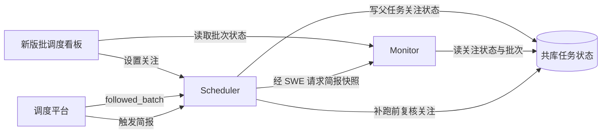

# 批调度任务关注详细设计

在「批调度看板（新）」的批次详情中提供父任务关注等级（`0`–`5`，`0` 为不关注）。等级按父任务保存，在同一来源的管理员之间共享；等级为 `1` 及以上时，该父任务的批次进入当日失败补跑与批调度简报的关注范围，并在同一模型池内优先派发。外部平台定时补跑通过新增的 `task_scope=followed_batch` 选取关注批次。

## 1. 操作与生效范围

- 管理员打开一个批次，在父任务名称旁选择关注等级 `0`–`5`。同一父任务的多次跑批共享一个等级，等级覆盖该批的父成员和分发成员。
- 新建和存量任务默认 `0`。等级 `1` 及以上的既有批次可以进入下一次取数、补跑或派发排序，仍需满足各自的时间窗口和准入条件。
- 等级为 `1` 及以上时控制平台调用 `followed_batch` 的当日失败补跑、招乎批调度简报的批次范围，以及同一模型池内的派发先后。批内原生自动重试、看板人工重跑、普通任务补跑入口及看板全量查询各自沿用现有规则。
- 同一次补跑的失败时间窗口与扫描上界在受理时固定，关注等级按候选页读取，入队前复核。扫描开始后提升等级，下一次定时调用保证从头按其窗口筛选，本次调用可以命中尚未扫描的记录。把等级降为 `0` 在提交后阻止新的补跑入队。已经持久入队的尝试按现有执行规则处理。
- 简报在取数时读取关注状态，冻结后的正文按已保存内容投递。取消关注影响下一次取数。两条链路使用同一关注规则，各自保留取数时点和时间窗口。

## 2. 数据与服务职责

关注状态由 Scheduler 写入共库 `swe_cron_job_states`，Monitor 只读。用批次触发回执的 `(tenant_id, source_id, agent_id, job_id)` 定位父任务状态行。回执中的 `job_id` 为触发批次的父任务 ID，批成员的 `job_id` 用于校验成员归属。关注与定义版本、队列失效水位、批次暂停状态独立。共库原有主键支持按完整身份点查。 [任务状态和回执表结构](../../deployment/cron_phase2_manual_create.sql)

| 拟新增字段 | 类型 | 语义 |
| --- | --- | --- |
| `batch_follow_level` | `TINYINT NOT NULL DEFAULT 0` | 父任务关注等级：`0` 未关注，`1`–`5` 越高越优先。`1` 及以上纳入筛选与派发排序。 |
| `batch_follow_updated_at` | `DATETIME(6) NULL` | 最近一次实际切换的 UTC 时间。 |
| `batch_follow_updated_by` | `VARCHAR(128) NULL` | 最近一次实际切换的可信网关 `actor_id`。 |

字段由运维执行增量 SQL，应用在相关读写入口检查字段就绪。存量记录以 `0` 生效，写接口只更新上述关注字段。重复提交同一状态成功返回当前值，保留上次实际切换的时间和操作者。管理员从多个批次操作同一父任务时，由同一状态行加锁串行化，以最后一次成功提交的值为准。状态查询使用现有主键和批次索引。

下面的链路图用于评审组件职责。



## 3. 看板接口与交互

### 3.1 设置关注等级

`PUT /api/scheduler/cron/managed-dispatch/batches/{batch_id}/follow`

沿用看板「暂停本批」的接入路径。浏览器传批次 ID 和所选来源，服务端根据可信网关身份校验 manager/admin，并严格校验同来源的真实、已受理批次。用回执解析父任务完整身份，校验父任务为 Scheduler 管理且尚未删除。父任务身份和操作者由服务端解析。 [现有批次写接口](../../../scheduler/src/scheduler/app/routers/managed_batch_operations.py) · [可信身份解析](../../../scheduler/src/scheduler/app/services/cron/managed/identity.py)

```json
{ "level": 3 }
```

```json
{ "batch_id": "example-batch-id", "batch_follow_level": 3 }
```

- `level` 为严格整数，取值 `0`–`5`，`0` 表示取消关注。非法参数依现有接口校验返回 422。无管理权限返回 403，跨来源、批次不存在或父任务已删除返回 404，状态行缺失或存储不可用返回 503。
- 沿用父任务定义行先加锁的约定。在事务中重读批次回执、核验父任务身份，再锁定父任务状态行并提交修改；同一事务内把新等级写入该父任务下仍在 `queued`/`dispatch_failed` 成员的 `dispatch_meta_json`，已派发与运行中的执行不变。补跑入队复核也在持有相同父任务锁后读取该状态行，按事务先后决定取消是否赶在入队之前。 [批次操作锁顺序](../../../scheduler/src/scheduler/app/services/cron/managed/batch_pause.py)

### 3.2 看板读模型与交互状态

- Monitor 的批次列表和详情统一从父任务状态行投影 `batch_follow_level`。活动父任务返回整数等级，已删除或状态缺失的父任务返回 `null`，看板不展示等级控件。同一父任务的任何批次都显示相同等级。批次列表在任务名下方显示黄色星标（等级 N 显示 N 颗），设置入口只有批次行右键菜单。 [批次读模型](../../../monitor/src/monitor/app/services/cron/managed_board.py) · [批次详情入口](../../../console/src/pages/Monitor/ManagedBatchDispatch/BatchDetail.tsx)
- 选择等级后控件进入提交中状态并禁用，拦截重复提交。写入成功后更新当前详情并刷新批次列表。提交失败保留上次已知等级，提示「关注等级更新失败，请重试」。切换来源或批次时，迟到响应只允许影响原操作的上下文。
- 滚动升级期间，旧 Monitor 返回的批次缺少 `batch_follow_level`，新版 Console 在这一状态下不出现右键等级项也不展示星标。右键菜单使用现有 Ant Design `Dropdown` 的 `contextMenu` 触发，不新增包裹 DOM。

## 4. 当日失败补跑

沿用 `POST /api/scheduler/cron/failure-reruns`，仅新增一个 `task_scope` 枚举值。外部平台切换后发送固定请求体。

```json
{
  "source_id": "RMASSIST",
  "task_scope": "followed_batch"
}
```

| `task_scope` | 筛选范围 |
| --- | --- |
| `all` 或省略 | 现有全范围入口。 |
| `batch` | 现有新版批调度范围。 |
| `ordinary` | 现有独立普通任务范围。 |
| `followed_batch` | 属于已关注父任务的真实新版批次，并符合现有补跑条件的当前失败成员。 |

已删除或已经不属于 Scheduler 管理的父任务退出补跑与简报的关注范围。

空关注清单命中零个成员。若调用同时传 `job_ids`，在关注范围内再按原有父任务或成员任务 ID 规则缩小范围，空数组命中零个。入口、返回的 HTTP 202、调用 ID、查询状态和分页计数沿用既有契约。 [补跑接入说明](../../integrations/cron-daily-failure-rerun.md)

1. **受理。** `DailyRetryFilters` 接受第四个值。调用继续使用筛选任务的持久状态和 `daily_retry_scope` 事件保存原请求范围。新模式单独校验关注字段就绪，字段缺失时返回 503。 [调用存储](../../../scheduler/src/scheduler/app/services/cron/managed/daily_retry_store.py) · [筛选事件](../../../scheduler/src/scheduler/app/services/cron/managed/daily_retry_audit.py)
2. **扫描。** 在现有主执行失败、结算失败两支分页查询上应用同一范围条件。按当前执行关联成员，按成员关联已受理的批次回执，再按回执父任务完整身份判定关注。保留来源与成员四元组严格相等检查。已被真实批次复用的普通执行按该批次处理，独立普通执行无批关系时不进入新模式。保留 `queue_order` 和现有时间索引分页。 [候选查询](../../../scheduler/src/scheduler/app/services/cron/managed/daily_retry_scan.py) · [范围过滤](../../../scheduler/src/scheduler/app/services/cron/managed/daily_retry_filters.py)
3. **入队复核。** 候选须关联同一条可验证的当前成员关系和批次回执。事务内验证冻结清单、当前成员指针和批次来源后，从同一个回执身份读取加锁的关注状态。关系无法唯一确认时按现有批次关系错误跳过，关注已取消则记为 `skipped`，原因 `cron_daily_retry_batch_not_followed`。与补跑执行登记和决策审计一并提交。 [入队锁与关联校验](../../../scheduler/src/scheduler/app/services/cron/managed/daily_retry_enqueue.py) · [筛选后入队](../../../scheduler/src/scheduler/app/services/cron/managed/daily_retry_service.py)
4. **资格。** 关注仅增加范围条件。最新尝试、既有排除错误、批次暂停、任务可执行性、原生重试是否耗尽、去重及 Worker 容量继续按现有判定。补跑只为失败成员登记下一次尝试。

候选页读取失败时，保留现有延后和租约恢复行为。单项入队事务内的关注读取失败时，按既有逐项处理记录为 `failed`，本项入队数为零。两类异常均禁止回退到全量范围。

## 5. 批调度简报

- 保留 `POST /api/scheduler/cron/batch-status-reports` 的 `source_id` 和 `recipient_ids`。SWE 内部转发、Scheduler 快照冻结、汇总先发和逐人分段沿用 [批调度简报详细设计](2026-11-24-cron-batch-status-report-design.md)。
- 在 Monitor 的简报 `batch_ctes` 中添加父任务关注筛选。以当前快照事务读取 `batch_follow_level>=1` 的父任务，限定同来源及业务日，当天计划时间已到才纳入。先筛入报告范围，再按既有规则排除全跳过、无成员等批次。通用看板查询 `batch_where` 保留原范围，简报汇总和明细共用筛选结果。 [快照筛选入口](../../../monitor/src/monitor/app/services/cron/batch_status_report.py)
- 汇总文案用「关注批次共 N 个」。零个时汇总显示「截至当前暂无可报告的关注批次」。共享模型池是来源级信息，标题标明「全来源共享模型池」。批次明细只含入选批次及其本批占用。模型池清单超过单条字节上限时按现有方式续发。失败分类和投递状态沿用当前契约。
- 关注筛选字段不存在或查询失败时，按现有取数故障处理。新版 Monitor 在内部快照返回 `batch_scope=followed_batch`，Scheduler 只冻结标明该范围的快照，旧版全量快照会按可恢复的取数失败处理。

## 5.1 派发优先级

批次候选按 `dispatch_lane='urgent'`、关注等级降序、批次受理时间、批次首个入队序号、批内顺位与入队序号排序。

- 共享 Worker 的批次按 `(source_id, provider_id, model_id)` 轮转，在各自模型池内比较等级。
- 文本批次走直派，在同一份直派候选列表内排序，无需按模型分池。独立直派执行排在文本批次前。
- 关注等级只调整符合派发条件的候选执行顺序。派发仍受 `not_before_at`、容量和退避条件约束。
- 等级来自入队时冻结的 `dispatch_meta_json`；改级会在同一事务内刷新已排队成员，因此对进行中的批次立即生效。
- 系统不提供饥饿保护：不老化、不设分级配额。等级是运营排序手段，不是调度时延保证。 [派发排序](../../../scheduler/src/scheduler/app/services/cron/managed/work_query.py)

## 6. 实施顺序和验收

| 顺序与交付 | 主要落点 | 验收 |
| --- | --- | --- |
| 1. 父任务关注状态和写接口 | 新增 `scripts/sql/cron_batch_follow.sql`，扩展 `scheduler/src/scheduler/app/routers/managed_batch_operations.py`，复用 `batch_pause.py` 的锁顺序 | 参考 `tests/unit/scheduler/test_managed_batch_pause.py` 增加关注用例。覆盖默认 0、同一父任务的两个批次、重复 PUT、取消、非管理员和跨来源、同裸 ID 的不同租户或 Agent。 |
| 2. 补跑第四种范围 | 修改 `daily_retry_filters.py`、`daily_retry_scan.py` 和入队复核，沿用调用筛选事件 | 扩展 `tests/unit/scheduler/test_daily_failure_retry_api.py`、`tests/unit/scheduler/test_daily_failure_retry_store.py` 和 `tests/unit/scheduler/test_daily_failure_retry_boundaries.py`。覆盖关注批父和分发成员、未关注、普通执行复用、身份歧义、`job_ids` 交集、空清单、旧三种范围和单项去重。在 `tests/integrated/scheduler/test_followed_batch_retry_mysql.py` 验证共库筛选、扫描后取消时入队为零及并发加锁。 |
| 3. 看板与简报读取 | 扩展 `monitor/src/monitor/app/services/cron/managed_board_sql.py`、`managed_board.py`、`batch_status_report.py` 和 Scheduler 简报模板 | 通过 `tests/unit/scheduler/test_managed_board_query.py`、`tests/unit/scheduler/test_batch_status_report.py` 和 `tests/integrated/scheduler/test_batch_status_report_mysql.py` 验证两批同状态、报告仅列关注批次、关注变化在下一次取数生效、汇总与明细一致、旧冻结消息正常投递、空关注时批次明细为零。 |
| 4. Console 接入 | 修改 `console/src/api/modules/managedBatchBoard.ts`、`console/src/pages/Monitor/ManagedBatchDispatch/BatchDetail.tsx` 和该页 `index.tsx` | 扩展对应 API、详情和列表测试。覆盖请求来源、切换状态、错误、重复点击、来源切换时的迟到响应和旧 Monitor 响应。按 `console/DESIGN.md` 在实际 Chromium 108 或对应 360 内核及当前浏览器验证交互，覆盖适用的 `hideMenu=true` 模式。 |

上线按以下顺序进行。

1. 执行增量 DDL，准备逐来源的首批关注父任务清单。新版 Monitor 会对所有来源的简报应用关注筛选，清单覆盖本次切换的简报与补跑作业。
2. 在首个服务实例升级前，暂停受影响的简报和旧范围定时补跑，等待已受理的旧调用结束扫描或投递。完成所有 Scheduler 实例升级后，通过经授权的设置入口初始化首批关注。完成 Monitor 与 Console 升级后，用测试来源核对关注写入、看板显示和实际简报范围。确认 Monitor 与 Scheduler 都使用新契约后再开放简报触发，避免新模板使用旧版的全量快照。
3. 把定时补跑作业请求体改为 `task_scope=followed_batch`，然后恢复定时补跑和简报作业。从测试来源核验两条链路、空关注范围和招乎回执。使用目标共库的 `EXPLAIN` 核对新筛选仍从既有候选分页和回执索引出发。
4. 回退时先暂停两类作业，保留关注列和已经持久化的调用。旧 Scheduler 无法解析新枚举。回退前处理完新模式调用，或保留待恢复新版后接续。平台重新启用前重新核对请求体和筛选范围。
