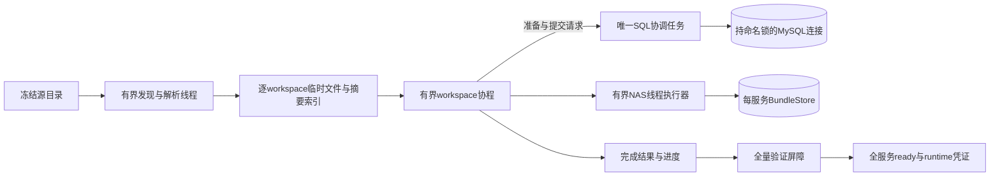

# 万级 workspace 离线迁移并行设计

日期：2026-11-11，状态更新于 2026-11-12。状态：实施中，CLI 已接入并行参数；完整规模与故障验收未完成。基于 `.worktrees/conversation-mysql-nas` 当前实现及前述 CLI 修复。本文保留目标设计；实际进度和证据见 `docs/superpowers/reports/2026-11-12-conversation-parallel-implementation-validation.md`，不能把设计条目视为全部已验收。

验收环境更新：用户已授权连接专用MySQL测试库，并明确本轮基于本地目录测试。因此本轮万级验收使用真实MySQL、独立本地目录及可控IO延迟；不把本地测量写成真实NAS性能结论。真实NAS参数在现场上线前复测，不再作为本轮完成的环境前置条件。连接凭据不得写入代码、文档或测试报告。

## 1. 目标与假设

面向至少10,000个workspace，在NAS高延迟场景重叠不同workspace的IO，降低完整停机窗口，而不降低全量语义校验强度。

- 全部旧writer仍必须停止，源在整个作业期间强冻结；mtime检查继续仅作为辅助。
- 同一应用schema仍只有一个协调作业，所有服务在同一manifest内。
- NAS支持现有独占发布、文件/父目录fsync及恢复协议；不改变bundle格式、正文保留策略、SQL schema。
- 资源受限，包括worker数、排队数、已解析数据、临时盘和数据库响应体。大workspace不能绕过限制。
- 数量不等于数据规模：验收同时记录总字节、最大workspace/Session/归档及文件数；不预承诺固定倍数加速。

## 2. 当前代码约束

| 入口 | 当前行为及设计影响 |
| --- | --- |
| `migration/discovery.py` / `inventory_v3.py` | 同步顺序扫描并集中返回完整解析对象；并发化必须同时限制驻留数据 |
| `migration/importer.py:ConversationImporter` | `self.store/self.bundles`随发布切换，session/chat/turn映射共享；不能多个workspace调用同一实例 |
| `migration/direct_import.py:DirectImporter` | 批次完成调用journal.hydrate，全量读取控制表并重建清单 |
| `migration/journal.py` | SQL是ID、操作key和批次状态的恢复权威；hydrate及_persist不能由多个worker并发调用 |
| `database/connection.py` | named_lock固定一条连接，session属于创建任务；子task继承ContextVar不代表可使用该连接 |
| `conversation_storage/publications.py:_nas_io` | 已有to_thread与取消后等待真实NAS线程结束的保护；新调度必须保留这个语义 |
| `migration/verify.py` | SQL查询、同步NAS读取和比较混在一起；需要拆出IO/比较边界，不能直接对整段协程gather |

### 关键选择

采用**单SQL协调者 + 多个workspace协程 + 有界NAS线程执行器**。协调者串行短事务，NAS IO可以重叠；不改通用数据库任务归属保护，不增加独立SQL writer连接。

不选择多进程直接迁移：现有全局锁/作业所有权不能被分片绕过，复杂的跨进程租约与提交协调没有必要。
不选择“同一导入器加gather”：共享store及数据库任务归属会破坏正确性。
不选择先预写所有bundle再统一提交：无法控制孤儿正文和临时盘，恢复窗口过大。

## 3. 执行结构



协调任务就是进入named_lock的原task，不能在进入锁后另建“SQL服务task”复用session。它持有DMLDatabase、journal、权威manifest，并持续消费有界请求队列。workspace task不持有裸数据库或可写manifest。

请求是固定领域操作（如分配身份、reserve publication、读取验证数据、commit publication），不是任意SQL字符串或任意callback。每个请求在协调task内完整开始/结束事务；不能把BEGIN与COMMIT分散成多个独立消息。协调task处理请求时不能等待worker的NAS操作，避免队列互等。

SQL协调者在等待IO期间定期使用同一连接做轻量存活/持锁检查（例如每15秒，作为内部常量）；核对当前connection_id持有实际命名锁且server_uuid/schema未变化。检查失败停止接单，不自动换连接恢复提交。此检查缩短故障发现时间，不构成NAS跨进程fence。

worker收到不变的票据和scope上下文；NAS线程只接收路径、BundleStore、块内容或临时文件句柄，不接收数据库连接/manifest。自定义线程提交应使用干净上下文，不能把数据库session ContextVar当作可跨线程资源。

## 4. 并发粒度与顺序

| 单元 | 并行与依赖 |
| --- | --- |
| workspace发现 | 服务配置索引由协调流程扫描；独立配置/目录解析进入有界worker；归属、覆盖、冲突在汇总屏障检查 |
| workspace内容盘点 | 不同workspace并行解析；每个结果立即写临时文件，只保留摘要 |
| workspace导入 | 不同workspace并行，单workspace内保留artifact→identity→Session→Chat archive的原顺序 |
| 同一Session/Chat | 不并发写；共享Session、多Chat的依赖按原逻辑处理 |
| 分享 | 初版保留在所有workspace完成后的独立阶段；正文读取可有界并行，原八字段比较/定位回填由SQL协调者处理 |
| 全量验证 | 不同workspace并行，SQL查询经协调者排队，NAS读取进入IO线程；分享/保留文件也走有界任务 |
| finalize | 执行完整并行验证后，全局屏障串行置ready、生成完整服务凭证 |

同一workspace使用独立执行上下文和内部映射。bundle/store按参数显式传递，移除导入期间改写共享self.store/self.bundles；不可仅靠约定“同服务就安全”。位置position、registry_order、消息序号及全局workspace索引取规范排序结果，与完成先后无关。artifact position包含的workspace序号不得因流式处理重排。

SQL自增ID首次分配可随调度顺序改变；业务ID、内容、归属必须相等，同作业SQL票据一旦分配必须永久复用。跨新作业对比语义，不能要求内部整数ID逐值一致。

## 5. 每次Publication的流水线

1. worker向协调者申请实体/Publication票据；SQL先提交持久映射，返回target_id、operation_key、scope和定位。
2. 协调者执行现有reserve/计划检查短事务，返回committed或待发布状态。
3. worker对已committed批次读取并核验；待发布批次执行confirm已有bundle或独占publish。线程内完成原fsync语义，不持SQL事务等待NAS。
4. worker读取/核验blocks，把限定大小的结果返回协调者；协调者核对scope、票据、SQL状态及预期定位后调用现有commit逻辑。
5. SQL提交成功后更新内存映射与增量进度；才释放该批内存/临时文件及调度额度。

prepare/commit固定操作继续复用现有DML/PreparedInsert白名单，不能通过RPC引入acquire或DDL逃逸。无法完全分离的现有reserve/commit方法必须重构其NAS读取为显式阶段，不能让协调task再次等待慢NAS而串行化整条流水线。每个隐藏NAS调用都列入实施审计清单。

## 6. 万级数据的内存、临时盘与控制面

### 6.1 逐workspace盘点文件

原inventory接口仍可供小型单元测试使用；v3 CLI增加迭代结果接口。审计目录外或其独立子目录中，创建本次run专用工作目录，禁止与冻结源/正文根重叠、软链接、共享其他作业文件。

- 规范排序后的workspace描述索引只保留scope、position、root、计数、解析文件校验和、输入边界及格式版本。
- 临时文件用私有目录/0600、原子写入，包含敏感正文；不放公共日志。
- 当单workspace解析结果达到内存阈值，序列化/解析采用流式对象或逐Session段文件，不能先完整read_bytes后再声称有内存上限。
- 超出单Session/旧格式reader的已知硬上限时明确blocker，在任何业务导入前报告；允许用户提高预算，不静默跳过。
- 每个CLI调用重新解析/核对冻结源；本地临时文件不作为跨命令权威缓存，不用它替代最终源对账。
- 引入临时盘高水位背压/空间预检；若全量盘点文件无法容纳，导入前失败。空间不足不得边丢校验数据边继续。

完整导入前仍需全局盘点通过，避免读到第9000个workspace才发现可预检的源错误。因此初版落盘全量inventory，分批读取导入；正文驻留内存随并发窗口增长，而非随总workspace数量增长。临时盘占用与总解析数据规模相关，必须测量和申报。

### 6.2 Journal与源变化检查

- 作业启动/续跑全量hydrate一次，分页读取；运行中按当前ticket/batch更新局部映射，不能每完成一批重新读取所有entries。
- manifest包含的既有镜像数据在启动时与SQL对账；本地镜像允许落后，绝不允许领先/改写SQL身份。
- 不可变源/target/authority保持原文件；新增进度输出独立于源绑定。原manifest镜像在阶段结束/有序退出写一次；崩溃从SQL重建。不要再每次allocate都重写不断增长的完整JSON。
- v3 CLI运行态不再调用当前整JSON load/全assignments校验链，也不维护全量assignments/batches字典。大旧manifest通过流式解析，将镜像票据逐条与SQL对账，必要索引写本次本地临时盘；不修改原持久格式、不跳过旧镜像一致性校验。新的直接清单仍可只含源绑定及空/滞后的进度镜像，SQL为恢复权威。阶段末镜像写出也须迭代SQL/索引并原子替换，不先构造全集dict；版本兼容与流式特殊值处理须在第2/3步原型验证。
- 热路径按活跃workspace维护映射，已完成对象可释放；SQL按key查询冷票据。启动对账及镜像输出也应分页/流式，不能用一次fetch_all把总量内存重新抬高。
- 首次import/resume --apply在journal.prepare之前，按规范顺序固定全部服务/租户（含仅分享租户）的同步起点，保持现有source_binding_text契约。不能让worker按需首次创建/刷新cutoff；resume保留全部既有值。worker入队前和完成后只检查所属输入；全局最终复核必保留。避免每批都扫描所有workspace。结构覆盖和mtime语义不减弱，扫描结果不可跨最终屏障复用。

此项与并发同步实施，否则串行journal/重复遍历可能吞掉IO收益。

## 7. 资源参数（CLI 已接入，现场定参待验收）

| 参数 | 初始设计值 | 作用 |
| --- | --- | --- |
| `--workers` | 默认4，范围1–32 | 同时活跃的workspace/验证任务；1用于串行兼容诊断 |
| `--io-workers` | 默认4，范围1–32 | 所有源解析/临时文件/NAS调用共享的线程上限 |
| `--memory-budget-mib` | 默认512，最小128 | 并发解析/待提交正文预算，不含解释器固定开销；超大单元须分段或拒绝 |
| `--work-dir` | 默认使用TMPDIR生成私有目录 | 全量盘点临时文件与分段正文；必须有充足磁盘 |

队列容量默认为2×workers，不另暴露旋钮；SQL请求队列有同样上限，并限制返回/请求正文总字节。仅任务数量限制不足，所有已提交到执行器但未结束的任务也计算在额度内。单任务可能占整个预算时单独执行，超过reader可分段上限则先失败。

参数应用于discover/freeze/inventory/plan/inspect/preflight/import/resume/verify/finalize的源读取及各自并行阶段；inventory/plan/inspect及import/resume/finalize无apply的源端预览不得连接业务DB；preflight即使无apply仍连接目标并校验schema、分享与作业门禁，不写业务数据。CLI新增参数统一注册，避免旧_command分派遗漏；旧offline路径不接受这些参数或明确报仅direct支持，不默默忽略。

2026-11-12 输入边界补充：各阶段共用明确会话入口（registry、sessions、dialog及审核的Session override和对应ledger），附件/代码/技能业务树不递归枚举或计量。配置证据和分享父目录只浅检查，未知workspace覆盖检查保留并在已登记workspace剪枝。旧非空fingerprints保持原全源契约。预检在枚举时按每worker额度检查文件单项/累计字节和去重entry数，entry包含必要目录，不能先全量构造路径列表后才拒绝；默认512MiB/4workers对应每workspace262144entry，预算不是整个作业workspace数限制。

并发参数是运行策略，不属于作业绑定：同manifest resume允许调整workers/io-workers/预算，不得改变source、target、IDs、operation_key。不增加batch-size调优参数，本轮保留原批大小限制。

当前 direct v3 CLI 用法（参数值为示例，非性能建议）：

```bash
swe conversation-storage import --manifest /audit/manifest.json \
  --workers 8 --io-workers 8 --memory-budget-mib 1024 \
  --work-dir /migration-tmp --apply
swe conversation-storage verify --manifest /audit/manifest.json \
  --workers 8 --io-workers 8 --memory-budget-mib 1024 \
  --work-dir /migration-tmp
```

4/8仅为待测初始值，不能当作现场最优值。初版不实现动态自适应或每服务多套参数；各service轮转入队避免一个服务占满窗口，最慢workspace不阻塞其他已就绪SQL请求。

## 8. 失败、取消和续跑

- 源归属/文件损坏/共享字段变化：停止新任务调度；不得把失败workspace从作业中排除后置ready。
- 首个不可恢复错误后，协调者进入stopping，只允许已受理事务完成或对账；禁止新Publication提交。完成未知的SQL立即终止写入，保留待恢复状态。
- stopping必须结清全部RPC Future：正在入队、已入队及正在处理的请求都获得已提交结果、明确拒绝或unknown；不能停消费队列后直接等待worker，否则worker等RPC、协调者等worker会死锁。原持锁task取消先延迟传播，完成当前事务的提交/回滚/unknown判定，关闭入队并给待处理请求返回异常，再join worker并drain IO。重复取消不能中断清理，清理结果持久记录后才传播退出。
- 已在线程内执行的NAS IO不能靠task.cancel中断。保留现有shield/drain语义，等待所有真实IO结束或维持“未排空、不可安全退出”的明确状态；不把超时退出伪称drained。
- 原task在正常错误清理时持锁到IO排空；连接丢失则不能假装仍持锁，立即停发任务并排空线程，不尝试重新连库接续本轮提交。
- 如果持锁连接意外断开，其他进程可能取得锁，而旧NAS线程尚未退出。沿用运维停写/进程退出门禁：resume前必须确认前一迁移进程已结束且NAS IO已排空；不把命名锁当作NAS跨进程fence。本轮不引入不可靠的本地锁或新DB writer租约来掩盖此限制。
- 硬杀后已有bundle可能未提交；同manifest恢复按现有operation_key核验并提交，未知结果不换key重放。局部已提交保留，workspace整体未完成可重入。
- 临时解析文件中断可丢弃并重建，SQL票据不能丢弃；worker数改变不影响续跑正确性。ready后仍禁止import/resume。

## 9. 验证与报告

验证前必须所有导入worker、SQL请求、NAS线程完成，整体job已imported；finalize完成全量复核前不能ready。

拆分SQL只读采集→NAS读取→语义比较。SQL经协调task的ReadOnlyDatabase白名单采集，NAS在受限执行器；每任务局部结果，不共享可变report，统一按position排序合并。覆盖集合必须等于完整inventory，不能仅以成功任务数判定通过。verify保持不写业务数据；finalize仅在验证后写控制状态/凭证。

stdout继续只输出最终JSON。stderr定期输出已完成/总workspace、Session/Chat/字节计数、队列深度、活跃IO、SQL等待/耗时、峰值内存/临时盘、blocker数；不输出token或正文。失败同时保存结构化报告，包含具体position及失败阶段、IO是否排空；不在失败时把ready置true。

## 10. 测试与性能验收

| 类别 | 必须证明 |
| --- | --- |
| 并发真实性 | 用可控阻塞IO证明至少2个独立workspace同时在执行，观察峰值不超过workers/io-workers；workers=1保持顺序语义 |
| 数据库归属 | 所有SQL由进入named_lock的同task调用；事务不交叉，不允许worker获得raw session，DML-only保持 |
| 跨scope | 双服务/多租户/相同外部ID、大量共享Session的Chat不串store/定位；报告与串行语义等价 |
| 顺序与映射 | 打乱worker完成顺序不改变registry/message顺序、artifact positions；同作业resume复用所有已分配票据 |
| 续跑故障 | 全租户cutoff在prepare前固定、worker调度不改变source binding；SQL票据后、NAS链接前/后、commit响应丢失、manifest镜像前后、进程取消/持锁连接丢失注入；重启后无重复丢失 |
| 背压 | 队列满/正在put/正在处理时重复取消，所有RPC Future结清；慢SQL、慢NAS、超大workspace、临时盘不足，内存/提交任务数不无界增长；无排队死锁 |
| 全量验收 | 一个任务失败/漏任务/源变动阻止ready；预览不连DB，verify不写业务库，分享旧八字段不变 |
| Journal规模 | entries数量倍增时每批不触发全表扫描/全JSON重写；最终语义与故障恢复测试仍通过 |

验收数据至少10,000 workspace，包含长尾大Session/归档、空workspace、全部服务分享和独立Session；不是10,000空目录。为1/4/8/16线程记录端到端discover→finalize耗时、各阶段吞吐、SQL时间、NAS IO/时延、RSS、临时盘峰值及错误率。

在同一冻结数据/独立目标上与workers=1对比；带可控NAS延迟的测试要求IO主导阶段有可重复吞吐提升且结果完全一致；真实NAS以实测饱和点选默认值。若SQL已占主导，不靠增加线程承诺加速，报告串行占比并另评估SQL批量优化。本轮不把“单元测试通过”当成万级目标环境验收。

## 11. 实施拆分与验收顺序

1. 基线观测：固化串行语义结果及各阶段耗时，找全所有同步NAS调用和全量重写入口。
2. 纯解析/盘点与IO执行器：有界调度、临时文件、全局覆盖检查、兼容现有报告。
3. SQL协调接口与worker上下文：保持workers=1通过全部回归，验证任务归属及DML边界。
4. Publication准备/IO/提交拆分，移除共享store切换，journal增量更新/分页恢复；开启多workspace并发。
5. 全量verify/finalize相同并发与资源预算，完成错误/取消/续跑矩阵。
6. 万级样本、专用MySQL及本地目录/可控IO延迟演练，记录默认参数表现，更新操作手册和放行清单；真实NAS上线前复测。

每步均有独立可测边界，最终以完整链路验收。不把“只加workers参数但底层同步IO未移出事件循环”视为完成。

## 12. 影响文件与未定项

主要涉及CLI三个模块；migration/discovery、inventory_v3、importer、direct_import、install_records、journal、verify；新增migration内的调度/临时盘点模块。通用DatabaseConnection任务归属和线上Publication语义保持，优先通过迁移专用拆分接口复用能力。

实施前的小型原型需确认：旧Session reader的最大整块内存需求、临时文件编码对现有特殊值/类型的往返、SQL-only reserve/commit所需NAS验证证据的最小接口。若无法在原语义下拆分，先完成接口测试，不能放宽校验。

设计经子代理只读复核，已补齐全租户cutoff不可随调度变化、SQL请求取消结清、旧大manifest流式兼容三项约束。流式兼容与Publication拆分仍需实施原型证明，不能仅凭设计宣称已经具备万级性能。

现场仍需给出源规模与NAS/临时卷性能用于定参；这不影响先实施保守有界并行。无需用户重新提供所有workspace路径，沿用自动发现。
